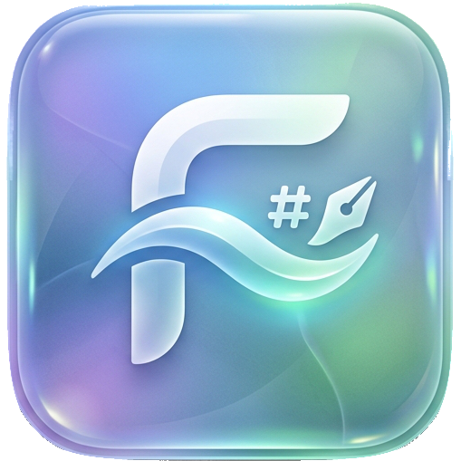
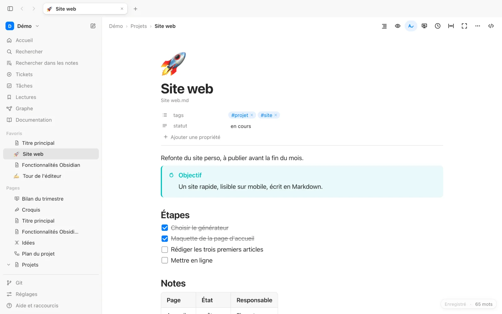
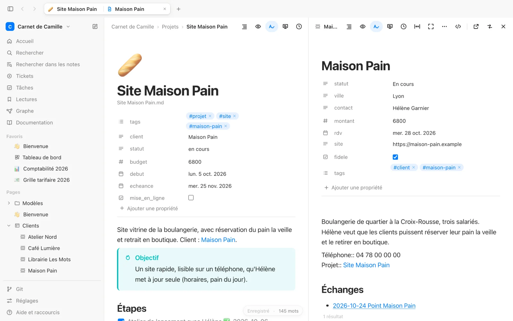
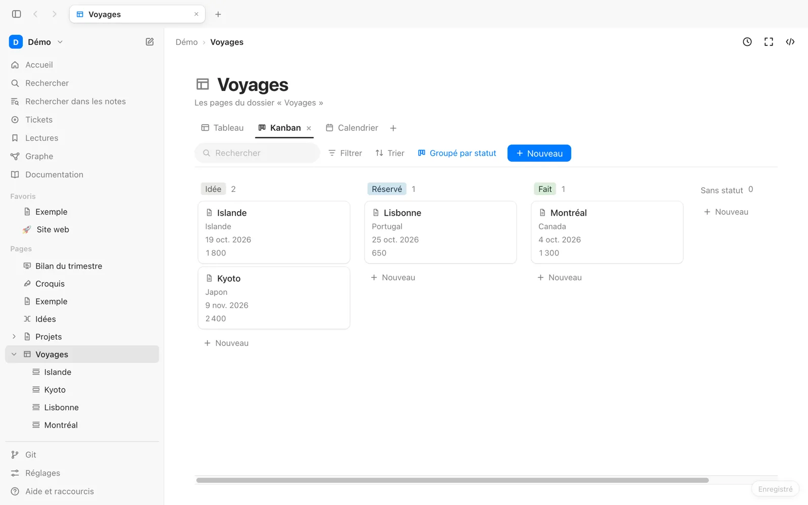
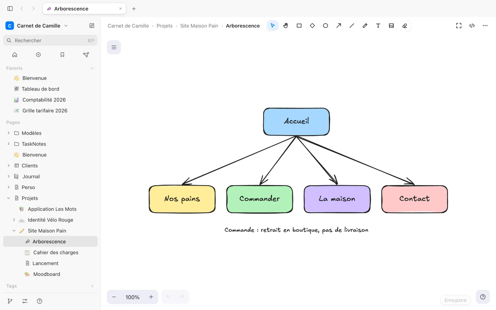
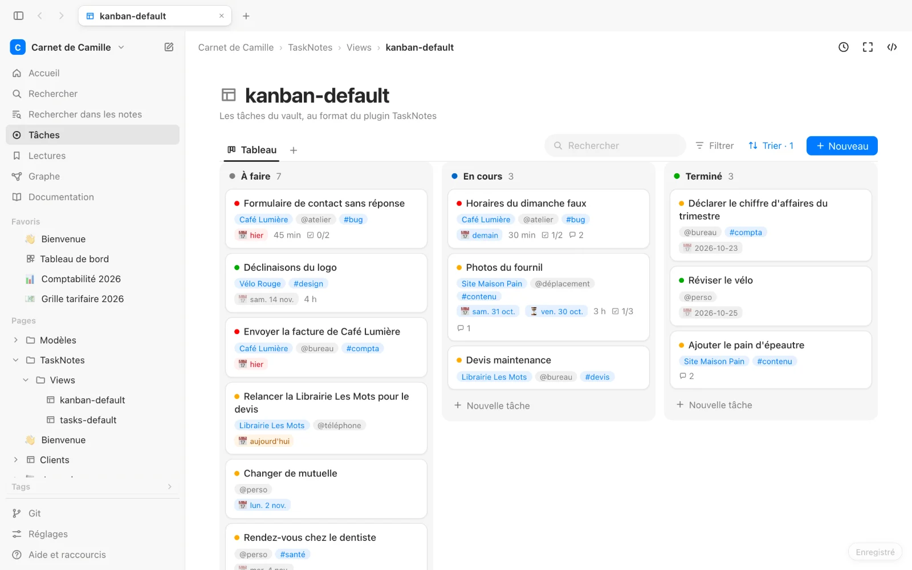

<p align="center">
  
</p>

<h1 align="center">FlowNote</h1>

<p align="center">
  L'édition par blocs, directement sur votre vault Obsidian.<br>
  Vos fichiers Markdown restent la seule source de vérité.
</p>

---

FlowNote est une application de bureau pour macOS (et Ubuntu) qui ouvre un dossier de notes Obsidian et permet de les éditer par blocs : menu `/`, glisser-déposer, tableaux, callouts… Il n'y a ni base de données ni format caché : chaque note reste un fichier `.md` que vous pouvez continuer à ouvrir dans Obsidian, sans plugin.

Autour de l'éditeur : des bases (tableau, kanban, galerie, calendrier), des canevas, des dessins Excalidraw, des mind maps, des tâches au format du plugin TaskNotes (liste, tableau kanban, agenda, calendrier), une liste de lectures, des dashboards de widgets, des présentations Marp, un graphe des liens et un gestionnaire Git intégré. FlowNote lit aussi les requêtes des plugins **Dataview** et **Tasks**, les notes intégrées (`![[Note#Section]]`) et les notes de bas de page. Tout reste du texte, lisible dans Obsidian et propre dans Git.

Les nouveautés de chaque version sont dans le [CHANGELOG](CHANGELOG.md).

<picture>
  <source media="(prefers-color-scheme: dark)" srcset="src/docs/images/editeur.dark.webp">
  
</picture>

| | |
| --- | --- |
| <picture>  <source media="(prefers-color-scheme: dark)" srcset="src/docs/images/split-view.dark.webp">  </picture> | <picture>  <source media="(prefers-color-scheme: dark)" srcset="src/docs/images/base-kanban.dark.webp">  </picture> |
| **Split view** : deux pages dans un onglet | **Bases** : tableau, kanban, galerie, calendrier |
| <picture>  <source media="(prefers-color-scheme: dark)" srcset="src/docs/images/croquis.dark.webp">  </picture> | <picture>  <source media="(prefers-color-scheme: dark)" srcset="src/docs/images/taches-tableau.dark.webp">  </picture> |
| **Dessins** Excalidraw | **Tâches** |

La documentation complète, illustrée, est dans l'app (« Documentation » dans la barre latérale) et dans [`src/docs/documentation.md`](src/docs/documentation.md).

## Fonctionnalités

**Interface**
- Onglets en haut de la fenêtre, barre latérale avec le vault (et ses vaults récents), Accueil, Rechercher, Tâches, Lectures, Graphe, Documentation et l'arbre des pages
- **Split view** : deux pages côte à côte (`⌥-clic` sur une page, `⌘⌥\` pour fermer le panneau)
- Documentation intégrée de toutes les fonctionnalités
- **Palette de commandes** (`⌘⇧P`, ou `>` dans `⌘P`) : toutes les actions de l'app par leur nom, avec leur raccourci
- Arbre des pages : menu « … » ou clic droit (renommer, supprimer, dupliquer, copier le lien, afficher dans le Finder, sous-page, nouveau dossier), glisser-déposer des pages et des dossiers, liens mis à jour à chaque déplacement
- Favoris d'Obsidian en haut de la barre latérale
- Pastille d'état en bas à droite de la page : enregistrement, nombre de mots, messages
- Réglages dans un onglet (`⌘,`), rangés par catégorie : thème, taille de l'interface, police (Système, Clarika, Open Sans, Inter), menu des blocs en liste ou en grille d'icônes
- Barre latérale masquable (`⌘\`), qui réapparaît au survol du bord gauche
- Pleine largeur par page et mode focus (`⌘⇧M`, Échap pour en sortir)
- Menu « … » de la page : export en **PDF** (note, présentation, dessin, mind map) et export de la note en page **HTML** autonome, images comprises
- Icône de page : un emoji choisi au-dessus du titre (propriété `icon`)
- Accueil : créer, récents, à faire, à lire, graphe, Git, activité et statistiques du vault

**Éditeur de blocs**
- Titres, listes, tâches, citations, callouts Obsidian (`> [!note]`), admonitions HedgeDoc (`:::info`), toggles (callouts repliables), séparateurs
- Menu `/` pour insérer ou transformer un bloc, raccourcis Markdown à la frappe (`#`, `-`, `[]`, `>`, ```` ``` ````)
- Poignée de bloc : glisser-déposer avec imbrication, dupliquer, transformer, supprimer ; `⌥↑` / `⌥↓` déplacent le bloc
- **Extraire vers une nouvelle note** la sélection, un bloc ou la section d'un titre, remplacés par un lien `[[…]]` ; **fusionner** une note dans une autre, les liens suivent
- Cellules d'un tableur (Excel, Numbers) ou CSV collés en tableau Markdown
- Sommaire : `[TOC]` (comme HedgeDoc) affiche les titres de la note, `/sommaire` l'insère
- **Barre de mise en forme** sur le texte sélectionné : gras, italique, souligné (`<u>`, lisible dans Obsidian), barré, fluo, code, lien (`⌘K`), note de bas de page, gomme
- **Fluo en couleur** (`==🟢vert==`, rouge, bleu, jaune, violet), modifiable d'un clic sur le crayon
- Liens : `⌘K` sur une sélection, une URL collée sur du texte sélectionné, une adresse tapée devient cliquable ; une adresse collée seule prend le titre de sa page (`[Titre](url)`, `⌘⇧V` pour l'adresse brute)
- **Aperçu au survol** d'un lien vers une note : la note, le titre ou le bloc visé, dans une petite fenêtre
- **Niveau des titres** dans la marge (un clic en choisit un autre, `⌘⌥1` … `⌘⌥6`)
- **HTML** dans les notes affiché mis en page (blocs, texte entouré de balises, images), sans ses scripts
- Collage : le texte simple est lu comme du Markdown ; un seul bloc collé (une ligne d'une page web) garde le type de la ligne où il arrive
- **Colonnes de blocs** (`/colonnes`) : des blocs côte à côte, écrits en callouts `[!multi-column]` et `[!blank]` (convention des snippets CSS de colonnes d'Obsidian ; sans snippet, des callouts empilés)
- Images redimensionnées en tirant leur coin (largeur écrite comme Obsidian, `![[image.png|320]]`), agrandies d'un double-clic ; vidéos **YouTube** et **Vimeo** (``)
- Tableaux éditables avec poignées de lignes et de colonnes (insérer, déplacer, aligner, supprimer) ; taille choisie dans une grille à la création
- Blocs de code avec coloration syntaxique et autocomplétion du langage, diagrammes **Mermaid**, formules mathématiques **KaTeX** (`$x^2$` en ligne, `$$…$$` en bloc, avec aperçu en direct), emoji (`:calendrier`), date du jour (`/date`)
- **Organigrammes** [flowchart.js](https://flowchart.js.org) (blocs ```` ```flow ````, comme HedgeDoc), avec un éditeur visuel : étapes, formes et flèches sans écrire la syntaxe
- **Graphiques Plotly** (`/graphique`) au format du plugin Obsidian [obsidian-plotly](https://github.com/Dmytro-Shulha/obsidian-plotly) : blocs ```` ```plotly ```` en YAML ou JSON, graphiques interactifs, éditeur visuel (lignes, barres, aire, points, camembert, anneau, radar ; titres, tableau des valeurs, import d'un CSV), tous les types de Plotly en texte
- Propriétés YAML (frontmatter) éditables, celles du vault proposées à l'ajout, repliables ; tags, `[[wikilinks]]` et `![[embeds]]` avec autocomplétion, par alias aussi
- **Liens vers les titres et les blocs** : `[[Note#` propose les titres, `[[Note#^` les blocs (identifiant ` ^id` ajouté comme Obsidian), « Copier le lien vers ce bloc » dans le menu `⋮⋮` ; renommer un titre met à jour les liens qui le visent
- **Titres repliables** : une flèche au survol replie la section
- **Notes intégrées** : `![[Note]]`, `![[Note#Section]]` et `![[Note#^bloc]]` affichent le contenu de l'autre note, toujours à jour
- **Notes de bas de page** `[^1]` : appel en exposant (texte au survol), note numérotée en bas ; la barre de mise en forme en ajoute une sur la sélection (une fenêtre demande son texte), `/note de bas de page` au curseur
- Sous-pages et arborescence dans la barre latérale
- **Modèles** du dossier réglé dans Obsidian : une nouvelle page en part, `/modèle` en insère un ; `{{title}}`, `{{date}}`, `{{time}}` remplis aux formats d'Obsidian

**Requêtes Dataview et Tasks**
- Blocs ```` ```dataview ```` du plugin [Dataview](https://blacksmithgu.github.io/obsidian-dataview/) : `LIST`, `TABLE` et `TASK`, avec `FROM`, `WHERE`, `SORT`, `GROUP BY`, `LIMIT`, les propriétés, les champs `clé:: valeur` et les dates calculées
- Blocs ```` ```tasks ```` du plugin [Tasks](https://publish.obsidian.md/tasks/) : filtres par état, échéance, chemin, tag, priorité, tris et groupes ; les signes 📅 ⏳ 🛫 ✅ 🔁 ⏫ sont lus
- Cocher une tâche dans les résultats la coche dans sa note (seule sa ligne change)

**Canevas**
- Les canevas d'Obsidian (`Nom.canvas`) : cartes de note, de texte, d'image et de lien (titre et image d'aperçu, miniature des vidéos YouTube), groupes, flèches avec libellés, couleurs
- Écrits exactement comme Obsidian les écrit, pour des diffs Git propres

**Dessins**
- Une page peut être une note ou un **dessin** à main levée, avec [Excalidraw](https://excalidraw.com) intégré : formes, flèches, crayon, texte, images
- Les outils de dessin prennent place dans la barre d'outils de FlowNote
- Format du plugin Obsidian « Excalidraw » (`Nom.excalidraw.md`) : avec ce plugin, les dessins s'ouvrent aussi dans Obsidian ; sans lui, on voit le JSON du dessin

**Lectures**
- Une note `Lectures.md` : une section par thème, une case à cocher par lien, cochée une fois lu
- Tags Obsidian (`#tag`) sur chaque lien, et filtre par tags dans la vue Lectures
- Ajout rapide (`⌘⇧L`) avec le titre de la page lu automatiquement, vue dédiée et carte « À lire » sur l'accueil

**Dashboards**
- `Nom.dashboard.md` : des widgets (texte, tableau, graphique Plotly, diagramme Mermaid, mind map, croquis, base) à placer librement et redimensionner sur une grille pleine largeur ; chaque widget est une section `## Titre` de la note

**Tâches**
- Une tâche est une note au format du plugin **TaskNotes** (tag `task`, statut, priorité, dates prévue et d'échéance, projets, contextes), dont les réglages sont lus dans `.obsidian`
- Fiche de tâche : statut, priorité, dates, projets choisis parmi les notes, contextes, estimation, commentaires, **récurrence** (règles courantes ou sur mesure)
- Vues de TaskNotes : liste groupée, **tableau kanban** avec glisser-déposer, agenda, calendrier du mois ou de la semaine

**Présentations**
- Une note avec `marp: true` devient une présentation [Marp](https://marp.app) : diapos séparées par `---`, notes de l'orateur en commentaires
- Miniatures à jour pendant l'écriture, mode Présenter (`⌘⌥P`) avec vue présentateur, export en HTML autonome

**Bases**
- Des bases de données au format des Bases d'Obsidian (`Nom.base`) : chaque ligne est une note d'un dossier, chaque colonne une propriété YAML
- Vues Tableau, Kanban, Galerie et Calendrier ; filtres, tris, groupes, calculs en bas de colonne, formules (`round(budget / 7)`)
- Sélections colorées, saisie au clavier, glisser-déposer des colonnes, lignes et cartes
- Une base s'intègre dans une note avec `![[Nom.base]]`, et la page d'une ligne affiche les propriétés de sa base
- Menu d'une ligne (ouvrir, renommer, supprimer), valeurs déjà utilisées proposées en tapant et dans les filtres, liens cliquables dans les cellules

**Kanban**
- Les tableaux du plugin Kanban d'Obsidian (`kanban-plugin: board`) : listes et cartes glissées, cochées, modifiées en place, écrits comme le plugin

**Mind maps**
- Des cartes mentales éditées à la souris et au clavier ([Mind Elixir](https://mind-elixir.com)) : Tab pour un enfant, Entrée pour un frère, glisser pour réorganiser, export PNG
- Stockées dans une note `Nom.mindmap.md`, avec un plan lisible pour Obsidian

**Graphe**
- Le graphe des liens entre les notes : aperçu sur l'accueil et vue complète (zoom, survol, filtres)

**Correction**
- Grammaire et orthographe en français avec [Grammalecte](https://grammalecte.net), entièrement sur votre Mac, sans service en ligne
- Clic sur un mot souligné pour voir les suggestions, l'ignorer ou l'ajouter à votre dictionnaire
- Un bouton de la barre de page coupe ou réactive la correction sans changer le correcteur choisi

**Navigation**
- Recherche de page (`⌘P`), recherche et remplacement dans la note (`⌘F` / `⌘⌥F`), recherche dans tout le vault (`⌘⇧F`) avec des filtres par tag, dossier, propriété ou date de modification (aussi en syntaxe Obsidian : `tag:#projet`, `path:Dossier`, `[statut:fait]`)
- Fil d'Ariane cliquable, plan de la note (glisser un titre y déplace toute sa section), historique précédent/suivant, onglets retrouvés au lancement
- **Tags** en arbre dans la barre latérale, avec leurs compteurs
- **Notes liées** sous chaque note (les pages qui pointent vers elle)
- Mots et caractères de la sélection dans la pastille d'état
- Mode Markdown brut (`⌘⇧E`) avec numéros de ligne

**Git**
- Statut, diff, indexation et commit
- Pull (par fusion) et push
- Historique d'une note et restauration d'une version
- Résolution simple des conflits de fusion
- En option, les modifications depuis le dernier commit dans la marge de l'éditeur, avec le diff mot à mot et le retour à la version du commit

## Compatibilité avec Obsidian

C'est le cœur du projet : **une note que FlowNote n'a pas modifiée est réécrite à l'octet près**, et une note modifiée ne change que dans les blocs touchés. Le reste du fichier (espacements, style des listes, marqueurs, fins de ligne, BOM…) est conservé tel quel.

- Frontmatter YAML, `[[wikilinks]]`, `![[embeds]]`, `#tags`, pièces jointes : tout reste lisible et éditable dans Obsidian. Les pièces jointes d'une note la suivent quand elle change de dossier.
- Les blocs sans équivalent Markdown standard utilisent une syntaxe qu'Obsidian affiche nativement (callouts pour les toggles, blocs ```` ```mermaid ````…).
- Les requêtes Dataview et Tasks, les notes intégrées et les notes de bas de page gardent leur syntaxe : Obsidian (avec ses plugins pour Dataview et Tasks) les affiche de la même façon.
- Tâches, lectures et présentations sont des notes ordinaires : propriétés YAML (`tags: [task]`, `status`, `marp: true`…), cases à cocher et callouts, que les plugins TaskNotes et Marp Slides savent aussi lire.
- Exceptions assumées : les codes emoji (`:warning:`) et les dessins (`.excalidraw.md`) demandent un plugin Obsidian pour être rendus ; sans lui, on voit leur texte.
- Les bases utilisent le format des Bases d'Obsidian : tableau, galerie et kanban s'y ouvrent tels quels. Le calendrier, qu'Obsidian n'a pas, y apparaît en galerie ; les couleurs et types des colonnes sont rangés sous une clé `flownote:` qu'Obsidian conserve.
- Le dossier `.obsidian` n'est jamais modifié. FlowNote lit seulement ses réglages de liens et de pièces jointes.
- FlowNote n'accède qu'au vault ouvert : un vault Obsidian (avec `.obsidian`) ou un dossier choisi dans « Ouvrir un vault ».
- Une note modifiée ailleurs (Obsidian, git) n'est jamais écrasée : l'écriture est refusée et la différence est signalée.

## Installation

1. Téléchargez `FlowNote_x.y.z_aarch64.dmg` depuis la page [Releases](https://github.com/florentfougeres/FlowNote/releases).
2. Ouvrez-le et glissez l'app dans le dossier **Applications**.
3. **Premier lancement** : l'app n'est pas encore signée par un certificat Apple Developer, donc macOS la bloque. Ouvrez *Réglages Système → Confidentialité et sécurité*, puis cliquez sur **Ouvrir quand même**. Si macOS indique que l'application « est endommagée », exécutez une fois :

   ```sh
   xattr -cr /Applications/FlowNote.app
   ```

Configuration requise : Mac Apple Silicon (M1 et suivants), macOS 11 (Big Sur) ou plus récent. Git doit être installé pour utiliser les fonctions Git (`xcode-select --install` ou Homebrew).

### Ubuntu 26.04

Téléchargez `FlowNote_x.y.z_amd64.deb` depuis la page [Releases](https://github.com/florentfougeres/FlowNote/releases), puis :

```sh
sudo apt install ./FlowNote_*_amd64.deb
```

apt installe aussi WebKitGTK s'il manque : le paquet n'embarque pas de bibliothèques, d'où sa petite taille. Le `.deb` est construit pour Ubuntu 26.04 (x86_64) ; sur une autre version, il peut demander des bibliothèques absentes.

## Développement

Prérequis : [Node.js](https://nodejs.org) 20+, [Rust](https://rustup.rs), [uv](https://docs.astral.sh/uv/) et les outils en ligne de commande Xcode.

Au premier lancement, `scripts/build-grammar.sh` télécharge Grammalecte (version fixée, empreinte vérifiée) et le compile en un exécutable embarqué dans l'app (`src-tauri/binaries/`).

```sh
npm install
npm run tauri dev        # app de bureau, avec rechargement à chaud
npm run dev              # version navigateur (Chrome) sur http://localhost:1420
```

| Commande | Rôle |
| --- | --- |
| `npm test` | Tests unitaires (Vitest), dont le contrat app ↔ backend |
| `npm run typecheck` | Vérification TypeScript |
| `npm run lint` | Analyse du code (oxlint) |
| `npm run fidelity -- <vault>` | Vérifie, en lecture seule, que chaque note d'un vault est réécrite à l'identique |
| `cargo test --workspace --manifest-path src-tauri/Cargo.toml` | Tests Rust du backend (fichiers du vault, Git, Grammalecte, liens web) |

### Construire le `.dmg` en local

Sans passer par GitHub Actions, sur un Mac Apple Silicon :

```sh
npm install
CI=true npm run tauri build -- --bundles dmg   # src-tauri/target/release/bundle/dmg/FlowNote_x.y.z_aarch64.dmg
```

`CI=true` saute la mise en page de la fenêtre du `.dmg` par le Finder (comme dans la CI). Sans lui, la construction échoue sur `bundle_dmg.sh` si le Terminal n'a pas le droit de piloter le Finder (*Réglages Système → Confidentialité et sécurité → Automatisation*). Après un échec, supprimer l'image temporaire `rw.*.dmg` laissée dans `src-tauri/target/release/bundle/macos/`.

La première construction prend plusieurs minutes (compilation Rust et de Grammalecte). Pour ajouter un `.dmg` à une release existante : `gh release upload x.y.z <fichier>.dmg`.

### Architecture

Le fonctionnement interne (bibliothèques, moteur de fidélité Markdown, formats des types de page, backend Rust) est détaillé dans [docs/sous-le-capot.md](docs/sous-le-capot.md).

- **`src-tauri/core/`** : le backend Rust, sans dépendance à Tauri. Il gère les fichiers du vault, le Git système, la recherche plein texte, Grammalecte, l'ouverture des liens et la lecture du titre des pages web, derrière un aiguillage unique (`backend.rs`).
- **`src-tauri/`** : l'app Tauri autour de ce backend.
- **`src/markdown/`** : moteur de fidélité Markdown. Il parse avec remark/mdast, conserve la source de chaque bloc et ne re-sérialise que les blocs modifiés, en vérifiant l'équivalence.
- **`src/editor/`** : éditeur basé sur Tiptap/ProseMirror. Il contient le schéma, les vues de blocs, le menu `/`, le glisser-déposer, les poignées de tableau et la recherche.
- **`src/vault/`** : accès au vault, résolution des liens façon Obsidian, opérations sur les pages et client Git. `src/platform.ts` est le point d'appel au backend.
- **`src/base/`**, **`src/tasks/`**, **`src/reading/`**, **`src/presentation/`**, **`src/mindmap/`**, **`src/canvas/`**, **`src/graph/`**, **`src/drawing/`** : bases, tâches TaskNotes, liste de lectures, présentations Marp, mind maps, canevas, graphe des liens, dessins Excalidraw.
- **`src/query/`** : requêtes Dataview et Tasks (index du vault, langages, rendu des résultats).
- **`grammar/`** : petit programme compagnon qui fait tourner Grammalecte. Le backend lui envoie les paragraphes par l'entrée standard.

### Publier une version

Le guide complet est dans [docs/publier-une-version.md](docs/publier-une-version.md). En bref :

1. Ajoutez la version et ses changements en tête de `CHANGELOG.md`.
2. Mettez à jour la version dans `package.json`, `package-lock.json`, `src-tauri/tauri.conf.json`, `src-tauri/Cargo.toml` et `src-tauri/Cargo.lock`.
3. Commitez, puis poussez un tag : `git tag X.Y.Z && git push origin X.Y.Z` (sans `v`).
4. Le workflow GitHub Actions lance les tests, construit le `.dmg` et le `.deb` et prépare une release en brouillon. Relisez-la, puis publiez-la sur GitHub.

## Licence

[MIT](LICENSE) © 2026 Florent Fougères

Le correcteur livré avec l'application est un programme séparé, sous licence GPL v3 : [Grammalecte](https://grammalecte.net) d'Olivier R., et son lanceur `grammar/flownote_grammar.py`. Son code source est disponible sur le site de Grammalecte et dans le dossier `grammar/`.
