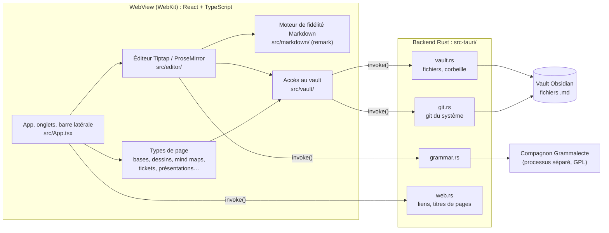

# Sous le capot

Ce document décrit le fonctionnement interne de FlowNote : les bibliothèques utilisées, leur rôle et la façon dont elles s'assemblent. Il s'adresse à quelqu'un qui veut lire ou modifier le code. La documentation pour l'utilisateur est dans l'app (et dans [`src/docs/documentation.md`](../src/docs/documentation.md)).

## Vue d'ensemble

FlowNote est une application [Tauri 2](https://tauri.app) : une interface web (React + TypeScript) affichée dans la WebView du système (WebKit sur macOS), et un petit backend Rust qui fait ce qu'une page web ne peut pas faire : lire et écrire les fichiers, lancer `git`, ouvrir un lien dans le navigateur.



Le principe qui guide tout le reste : **le vault Obsidian reste la seule source de vérité**. Il n'y a ni base de données ni fichier caché. Chaque type de page est un fichier texte lisible dans Obsidian, et une note qu'on ouvre sans la modifier est réécrite à l'octet près.

## Les bibliothèques

| Domaine | Bibliothèque | Où | Rôle |
| --- | --- | --- | --- |
| Application | [Tauri 2](https://tauri.app) | `src-tauri/` | Fenêtre native, WebView, commandes Rust appelées par `invoke()` |
| Interface | [React 18](https://react.dev) | `src/*.tsx` | Toute l'interface |
| Éditeur | [Tiptap 3](https://tiptap.dev) sur [ProseMirror](https://prosemirror.net) | `src/editor/` | Édition par blocs |
| Markdown | [unified](https://unifiedjs.com) / [remark-parse](https://github.com/remarkjs/remark) (mdast), avec `remark-gfm`, `remark-math`, `remark-frontmatter` | `src/markdown/` | Lecture du Markdown, avec les positions dans la source |
| Propriétés YAML | [yaml](https://eemeli.org/yaml/) | `src/markdown/frontmatter.ts`, `src/base/baseFile.ts` | Modifier le YAML sans perdre commentaires, ordre des clés ni clés inconnues |
| Coloration du code | [lowlight](https://github.com/wooorm/lowlight) (highlight.js) | `src/editor/codeHighlight.ts` | Coloration des blocs de code, en décorations |
| Diagrammes | [Mermaid](https://mermaid.js.org) | `src/editor/mermaid.ts` | Blocs ```` ```mermaid ```` |
| Maths | [KaTeX](https://katex.org) | `src/editor/math.ts` | Formules `$…$` et `$$…$$` des notes (embarqué ; les présentations le reçoivent par Marp) |
| Organigrammes | [flowchart.js](https://flowchart.js.org) (sur [Raphaël](https://dmitrybaranovskiy.github.io/raphael/)) | `src/editor/flowchart.ts` | Blocs ```` ```flow ```` et ```` ```flowchart ```` (comme HedgeDoc) |
| Graphiques | [Plotly](https://plotly.com/javascript/) (`plotly.js-dist-min`) | `src/editor/plotly.ts` | Blocs ```` ```plotly ```` (format d'obsidian-plotly) |
| Emoji | [emojibase-data](https://emojibase.dev) | `src/editor/emoji.ts` | Recherche `:nom` (en français) et `:shortcode:` |
| HTML des notes | [DOMPurify](https://github.com/cure53/DOMPurify) | `src/editor/html.ts` | Nettoie le HTML écrit dans les notes avant de l'afficher (pas de scripts, cadres ni formulaires) |
| Polices | [Open Sans](https://fontsource.org/fonts/open-sans) et [Inter](https://fontsource.org/fonts/inter) (`@fontsource/*`), Clarika | `src/styles/fonts.css`, `src/styles/fonts/clarika/` | Polices proposées dans les réglages (`data-font` sur la racine) |
| Croquis | [Excalidraw](https://excalidraw.com), [lz-string](https://github.com/pieroxy/lz-string) | `src/drawing/` | Dessins `.excalidraw.md` |
| Mind maps | [Mind Elixir](https://mind-elixir.com) 5.15.x | `src/mindmap/` | Cartes `.mindmap.md` |
| Canevas | [React Flow](https://reactflow.dev) (`@xyflow/react`) 12.11.x | `src/canvas/` | Tableau blanc `.canvas` (cartes, flèches, zoom) |
| Présentations | [Marp](https://marp.app) (`@marp-team/marp-core`) | `src/presentation/` | Diapos des notes `marp: true` |
| Bases | [TanStack Table](https://tanstack.com/table) v8 | `src/base/TableView.tsx` | Vue tableau des bases `.base` |
| Graphe | [d3-force](https://d3js.org/d3-force) | `src/graph/GraphView.tsx` | Disposition du graphe des liens |
| Animations | [Motion](https://motion.dev) | `src/editor/dragMotion.ts` | Animation du glisser-déposer des blocs |
| Correcteur | [Grammalecte](https://grammalecte.net) 2.3.0 | `grammar/`, `src-tauri/core/src/grammar.rs` | Grammaire et orthographe françaises |
| Côté Rust | `serde`, `trash`, `ureq`, `tauri-plugin-dialog` | `src-tauri/` | Échanges JSON, corbeille du système, titre et aperçu d'une page web, sélecteur de dossier |
| Outils | Vite, Vitest + jsdom, oxlint, TypeScript 7 | | Build, tests, lint, types |

Les bibliothèques lourdes (Excalidraw, Mind Elixir, React Flow, Mermaid, flowchart.js, Plotly, Marp, l'impression, les données d'emoji) sont chargées par `import()` dynamique, à la première utilisation : ouvrir une note simple ne les charge pas.

Deux versions sont figées volontairement : TanStack Table reste en v8 (la v9 change d'API) et Mind Elixir en 5.15.x.

## Le moteur de fidélité Markdown (`src/markdown/`)

C'est la pièce centrale. Un éditeur WYSIWYG classique lit le Markdown, le transforme en document, puis le réécrit entièrement à l'enregistrement : les `*` deviennent des `_`, les listes changent de puce, les espaces bougent, et chaque enregistrement produit un gros diff Git. FlowNote ne réécrit que les blocs modifiés.

### Lecture : du Markdown au document

`parse.ts` passe le texte à **remark** (`remark-parse` avec GFM, maths et frontmatter), qui produit un arbre **mdast** où chaque nœud connaît sa position dans la source. Cet arbre est converti en JSON ProseMirror :

- les détails de style (marqueur `*` ou `_`, puce `-` ou `*`, clôture ```` ``` ```` ou `~~~`) sont gardés en attributs ;
- le contenu des conteneurs (citations, callouts, éléments de liste) est extrait, débarrassé de ses préfixes (`> `, indentation) et reparsé ;
- la syntaxe propre à Obsidian, que CommonMark ignore (`[[wikilinks]]`, `![[embeds]]`, `==surlignage==`, `%%commentaires%%`, callouts `> [!note]`), est reconnue dans le texte après coup ; un emoji de couleur juste après `==` (`==🟢texte==`) devient l'attribut `color` du surlignage (`highlightColors.ts`) et est réécrit au même endroit ;
- le HTML qui entoure du texte (`<u>…</u>`, `<span style="…">…</span>`, liste dans `inlineHtml.ts`) devient une marque `inlineHtml` qui garde la balise ouvrante telle quelle ; une balise seule reste du texte brut. C'est ainsi que s'écrit le souligné, que Markdown n'a pas ;
- les admonitions HedgeDoc (`:::info` … `:::`) sont masquées pour remark derrière un commentaire HTML de même longueur (`maskContainers`), pour que les positions restent justes, puis lues comme des callouts ;
- ce que FlowNote ne sait pas éditer reste un bloc brut (`rawBlock`, `inlineRaw`), affiché et réécrit tel quel.

`note.ts` découpe ensuite le fichier ainsi :

```
[BOM][frontmatter][début][bloc 0][écart 1][bloc 1] … [bloc n][fin]
```

Pour chaque bloc de premier niveau, il garde **la tranche exacte de la source** et l'espace qui le sépare du précédent. Les fins de ligne CRLF et le BOM des fichiers Windows sont mis de côté et restitués.

### Écriture : du document au Markdown

ProseMirror ne recrée pas les nœuds qui n'ont pas changé : après une frappe, tous les blocs non touchés sont **le même objet JavaScript** qu'au chargement. `NoteSession` (dans `note.ts`) associe chaque bloc d'origine à sa source dans une `WeakMap` :

- un bloc qui est encore l'objet d'origine est réécrit avec sa source d'origine, à l'octet près ;
- un bloc nouveau ou modifié est sérialisé par `serialize.ts`, qui réutilise les marqueurs d'origine ;
- les écarts entre blocs sont repris de l'original quand les blocs voisins sont restés à leur place.

La sérialisation d'un bloc modifié essaie plusieurs **variantes**, de la moins invasive à la plus prudente : sans échappement, puis échappement des caractères porteurs de sens, puis marqueurs normalisés, puis échappement de toute la ponctuation. Chaque essai est reparsé et comparé au bloc voulu par `normalize.ts`, qui réduit un document à ce que voit le lecteur. La première variante qui redonne le même contenu est gardée : on n'échappe un `*` que s'il le faut vraiment.

Les propriétés YAML (`frontmatter.ts`) passent par le modèle de document de la bibliothèque `yaml`, qui conserve commentaires, ordre des clés et style des valeurs non touchées. Un frontmatter jamais modifié n'est pas réécrit du tout.

### Vérifier la fidélité

`npm run fidelity -- <vault>` (`scripts/fidelity.ts`, qui appelle `src/markdown/fidelity.ts`) parcourt un vault réel **en lecture seule** et vérifie que :

1. chaque note chargée puis enregistrée sans modification est identique à l'octet ;
2. chaque bloc, s'il était modifié, se réécrirait avec le même sens.

Il signale aussi la « dérive » : les blocs qui se réécriraient différemment au caractère près (ce qui se verrait dans Git si on les modifiait). Le même contrôle tourne dans les tests sur le vault d'exemple `fixtures/vault`.

## L'éditeur (`src/editor/`)

L'éditeur est construit sur **Tiptap 3**, une couche au-dessus de **ProseMirror**. Tiptap apporte l'organisation en extensions et l'intégration React ; ProseMirror fournit le modèle de document, les transactions, l'historique et les décorations.

- **`schema.ts`** : le schéma du document. Il suit exactement le sous-ensemble de Markdown géré par `src/markdown/` : chaque attribut relevé par le parseur (marqueurs, sources brutes) doit y être déclaré, sinon Tiptap l'efface et le bloc perdrait son style d'origine. Les tableaux viennent de `@tiptap/extension-table`.
- **`extensions.ts`** : assemble les plugins ProseMirror (historique, curseurs, coloration, recherche, correcteur, sommaire, échéances, marques de syntaxe) et les raccourcis clavier.
- **`views/`** : les vues de nœuds, un fichier chacune (callouts, images, embeds, blocs de code, Mermaid, Plotly, bases intégrées…), qui ajoutent des contrôles autour du texte éditable. Replier un callout est un état d'affichage : rien n'est écrit dans le fichier.
- **`slash.ts`, `wikilinks.ts`, `emoji.ts`, `menu.ts`** : les menus `/`, `[[` et `:` reposent sur `@tiptap/suggestion`.
- **`shortcuts.ts`, `keymap.ts`** : raccourcis Markdown à la frappe (`#`, `-`, `[]`, `>`) et clavier des blocs.
- **`BlockHandle.tsx`, `dragMotion.ts`** : poignée et glisser-déposer des blocs, en pointer events (WebKit refuse le drag HTML5 sur les `<button>`), animés par Motion.
- **`syntaxMarks.ts`** : affiche les `#` d'un titre et les `` ` `` du code autour du curseur, pour changer de niveau ou retirer le code sans la vue brute.
- **`bridge.ts`** : le pont entre l'éditeur et l'app (`VaultBridge`) : chemin de la note, liste des fichiers, chargement des images, création des pièces jointes, ouverture des liens. L'app le met à jour sans recréer l'éditeur.

Tout ce qui relève de l'affichage passe par des **décorations** ProseMirror, jamais par une modification du document : coloration du code, fautes signalées par le correcteur, résultats de recherche. Le Markdown n'est donc pas touché tant que l'utilisateur ne change rien.

### Enregistrement

`NoteEditor.tsx` crée une `NoteSession` au chargement et sérialise le document à chaque changement. L'app (`App.tsx`, et `SplitPane.tsx` pour le côté droit du split view) enregistre 700 ms après la dernière frappe, en passant au backend le contenu attendu du fichier : si le fichier a changé ailleurs (Obsidian, git), l'écriture est refusée et l'utilisateur est prévenu, au lieu d'écraser ses modifications.

### Blocs riches

- **Code** : lowlight (le moteur de highlight.js, langages courants) calcule des décorations, mises en cache par nœud.
- **Mermaid** : rendu au thème de l'app, avec `securityLevel: "strict"`. Le fichier garde un simple bloc de code.
- **flowchart.js** : blocs ```` ```flow ```` (ou ```` ```flowchart ````) dessinés en SVG par Raphaël, aux couleurs de l'app (`--text`, `--bg`), redessinés au changement de thème. Le dessin reçoit une `viewBox` pour se réduire à la largeur de la note. Même affichage que Mermaid (classe `is-mermaid`, source au clic). L'éditeur visuel (`FlowEditor.tsx`) passe par `flowModel.ts` : étapes et flèches lues de la source, réécrites en gardant l'ordre, les chaînes (`a->b->c`, mémorisées par ligne) et ce qu'il ne montre pas (`|past`, liens `:>`, paramètres, styles `@>`).
- **Plotly** : blocs ```` ```plotly ```` en YAML ou JSON, au format du plugin [obsidian-plotly](https://github.com/Dmytro-Shulha/obsidian-plotly). Seules des données statiques sont dessinées, aucun JavaScript n'est exécuté. Plotly 3+ n'affichant plus les titres en texte simple, `plotly.ts` les convertit en `{ text }` au dessin. `PlotEditor.tsx` et `plotModel.ts` forment l'éditeur visuel : un modèle « étiquettes + séries » pour les types qui y tiennent (`keysOf` dit où chacun range étiquettes et valeurs : `x`/`y`, `labels`/`values`, `theta`/`r`) ; les autres s'éditent en texte.
- **Maths** : reconnues par `remark-math` (`inlineMath` en `inlineRaw`, `math` en `rawBlock`), la source gardée telle quelle. `math.ts` charge KaTeX et sa feuille de style à la première formule affichée et les dessine (`throwOnError: false` : une erreur s'affiche en rouge). Une formule en ligne se modifie dans `MathPrompt.tsx` (rattaché à l'éditeur qui l'ouvre, le split view en ayant deux), un bloc par double-clic avec l'aperçu sous le champ. Règles de saisie dans `shortcuts.ts` : `$…$` comme Obsidian, `$$` + espace. L'export HTML écrit du MathML (`mathMarkup`).
- **HTML** : un bloc HTML (`rawBlock` de type `html`) s'affiche rendu après passage par DOMPurify (`html.ts`), ses images lues dans le vault ; une balise seule en ligne (`<br>`, ``) aussi. Le fichier garde la source telle quelle ; double-clic pour la modifier.
- **HTML tapé** (`typedHtml.ts`) : un paragraphe de texte simple contenant une balise est relu par le parseur quand le curseur le quitte ; s'il en sort du HTML, il est remplacé par ce que donnerait l'ouverture du fichier.
- **Copie et export** : `clipboardSerializer` (`NoteEditor.tsx`) et « Exporter en HTML » (`copyHtml.ts`) remplacent les images du vault par l'image elle-même (adresse `data:` dessinée depuis l'image affichée, `imageCopies.ts`).
- **Notes intégrées** (`views/noteEmbed.tsx`) : `![[Note]]` monte un `NoteEditor` en lecture seule avec le texte de la note, ou la section ou le bloc choisi (`src/markdown/sections.ts` : `#Titre` jusqu'au titre suivant de même niveau, `#^id` le paragraphe ou l'élément de liste marqué). La profondeur est limitée (une note qui s'intègre elle-même s'arrête là).
- **Notes de bas de page** : le parseur garde appels et définitions tels quels (`inlineRaw` et `rawBlock` de type `footnoteReference` et `footnoteDefinition`) ; leurs vues (`views/inlineRaw.ts`, `views/rawBlock.ts`) les affichent en exposant et en note numérotée. Le fichier ne change que si l'utilisateur modifie la note.
- **Dataview et Tasks** (`src/query/`) : `pages.ts` indexe le vault (propriétés, champs `clé:: valeur`, tags, liens, dates, tâches avec les signes du plugin Tasks), `dataview.ts` lit et exécute le langage de requête de Dataview (sans `FLATTEN` ni JavaScript), `tasks.ts` celui de Tasks, `render.ts` dessine les résultats sous le bloc de code. Les notes viennent de la copie en mémoire du vault (`noteCache.ts`), par `queryVault` du pont. Cocher une tâche passe par `toggleTask` : seule sa ligne est réécrite (`[x]` et `✅ date`), avec le contrôle de conflit habituel.
- **Palette de commandes** (`src/CommandPalette.tsx`) : la liste des commandes est construite par `App.tsx` ; les raccourcis affichés viennent de `shortcuts.ts` (`shortcutOf`).

## Les types de page

Chaque type a son dossier et un format de fichier compatible avec Obsidian ou ses plugins. Le principe est toujours le même : la partie écrite par l'utilisateur est gardée telle quelle, seule la partie gérée par FlowNote est régénérée.

| Type | Fichier | Bibliothèque | Format |
| --- | --- | --- | --- |
| Note | `*.md` | Tiptap | Markdown d'Obsidian |
| Base | `*.base` | TanStack Table, `yaml` | Format natif des Bases d'Obsidian |
| Dessin | `*.excalidraw.md` | Excalidraw | Format du plugin Obsidian Excalidraw |
| Mind map | `*.mindmap.md` | Mind Elixir | Plan lisible et JSON de la carte |
| Canevas | `*.canvas` | React Flow | JSON Canvas, écrit comme Obsidian |
| Dashboard | `*.dashboard.md` | grille CSS, pointer events | Sections `## Titre` = widgets, positions `[x, y, w, h]` dans `flownote-dashboard` (front matter), les widgets gênants poussés vers le bas (`settle`) |
| Ticket | note avec `type: ticket` | Tiptap | Note et commentaires en callouts |
| Présentation | note avec `marp: true` | Marp | Diapos séparées par `---` |
| Kanban | note avec `kanban-plugin: board` | pointer events | Format du plugin Kanban : `## Liste`, `- [ ] carte` |
| Lectures | une note | | Titres = thèmes, tâches = liens |

### Bases (`src/base/`)

Un fichier `X.base` au **format natif des Bases d'Obsidian** (YAML) décrit les vues ; les lignes sont les notes du dossier `X/` (filtre `file.inFolder("X")`), leurs propriétés sont les colonnes.

- Vues : tableau (TanStack Table), kanban, galerie, calendrier. FlowNote écrit le kanban en `type: kanban` (type natif d'Obsidian) et le calendrier, qu'Obsidian n'a pas, en `type: cards` avec `flownoteView: calendar`.
- Ce que les Bases ne stockent pas (types de colonnes, couleurs des options) va sous une clé `flownote:`. Obsidian conserve les clés qu'il ne connaît pas.
- Le YAML est modifié par l'API Document de `yaml`, pour ne rien perdre.
- `formula.ts` est un petit interpréteur d'un sous-ensemble du langage de formules d'Obsidian (nombres, texte, dates, `if()`, méthodes courantes). Ce qu'il ne comprend pas s'affiche en erreur dans la cellule, et la formule reste écrite telle quelle.

### Dessins (`src/drawing/`)

Les dessins sont stockés **comme le plugin Obsidian Excalidraw** : une note `Nom.excalidraw.md` qui contient la scène en JSON, sous la propriété `excalidraw-plugin: parsed`. On peut donc les ouvrir dans Obsidian avec ce plugin.

````
# Excalidraw Data
## Text Elements        ← texte de chaque élément, lisible sans le plugin
## Embedded Files       ← images : "<id>: [[image.png]]"
%%
## Drawing
```json                 ← la scène Excalidraw
{ "type": "excalidraw", "elements": [...] }
```
%%
````

FlowNote lit aussi le JSON compressé (`compressed-json`, décodé avec lz-string) mais écrit toujours du JSON en clair, plus lisible dans Git. Tout ce qui précède `# Excalidraw Data` est gardé tel quel. Excalidraw charge du WebAssembly, d'où `'wasm-unsafe-eval'` dans la CSP ; ses polices CJK viennent d'`esm.sh`.

### Mind maps (`src/mindmap/`)

Une note `Nom.mindmap.md` éditée avec **Mind Elixir**. Le fichier contient un plan en liste (régénéré, c'est ce qu'Obsidian affiche) puis le JSON de la carte entre `%%`, pour qu'Obsidian le masque en lecture. Mind Elixir écrit son zoom en `translate3d(…) scale(…)` dans le style ; l'affichage passe par une variable CSS (`--map-transform`) en 2D et en pixels entiers, pour rester net au zoom.

### Canevas (`src/canvas/`)

Un fichier `Nom.canvas` au format **JSON Canvas** d'Obsidian, affiché avec **React Flow**. `format.ts` lit le fichier (les flèches sans côté prennent celui qui fait face à l'autre carte, comme Obsidian) et l'écrit comme Obsidian 1.14 (vérifié dans son code) : indentation par tabulations, un objet dont toutes les valeurs sont simples tient sur une ligne, clés dans l'ordre d'Obsidian (`id, x, y, width, height, color, type`, puis le contenu ; `fromEnd`, `toEnd`, `color`, `label` après les côtés d'une flèche), clés inconnues gardées en tête, clés du fichier à leur place. Les cartes de texte et de note sont des `NoteEditor` (lecture seule, ou édition au double-clic). Une carte de lien demande au backend le titre et l'image d'aperçu de la page (`fetch_page_preview` : `og:title`, `og:image`, rendue absolue), une fois par adresse. La mention « React Flow » reste affichée, comme son éditeur le demande hors abonnement Pro.

### Tickets (`src/ticket/`)

Une note avec `type: ticket` dans ses propriétés, affichée comme une issue GitHub. Le fichier est coupé en deux : la tête (propriétés et description), éditée par l'éditeur de notes, et la section `## Commentaires`, lue comme un fil de callouts `> [!comment]` imbriqués. Chaque partie est réécrite telle quelle tant qu'elle ne change pas. Les tâches datées (`📅 2026-10-16`) alimentent les échéances.

### Présentations (`src/presentation/`)

Une note avec `marp: true`, découpée en diapos par `---` : c'est la syntaxe de **Marp**, aussi lue par les plugins de diapos d'Obsidian. Marp produit le HTML des miniatures, du mode présentation et de l'export HTML. Les liens et embeds d'Obsidian sont convertis pour Marp à l'affichage seulement (`forMarp`) : le fichier n'est jamais modifié. Marp tourne avec `inlineSVG: false`, car WebKit dessine mal `foreignObject`. Les notes de l'orateur sont des commentaires HTML.

### Kanban (`src/kanban/`)

Une note avec `kanban-plugin: board` dans ses propriétés, au format du plugin **Kanban** d'Obsidian : une liste par titre `## `, une carte par élément `- [ ] ` (ses lignes suivantes comprises), `**Complete**` pour une liste qui coche les cartes qui y arrivent. `format.ts` garde tel quel ce qui précède la première liste et ce qui suit la dernière (archive `***`, réglages `%% kanban:settings %%`) ; une liste n'est réécrite que si elle change, comme le plugin l'écrit (`## Titre`, ligne vide, cartes, deux lignes vides), donc un tableau non modifié reste identique à l'octet près. Le glisser-déposer suit le pointeur (pointer events), comme le tableau des tickets, dont il reprend les styles.

### Révisions (`src/review/`)

Les cartes de révision du plugin **Spaced Repetition**, lues dans les notes tagguées `#flashcards` (`#flashcards/x` : un paquet) : `Q::R`, `Q:::R` (deux sens), et sur plusieurs lignes `?` / `??`. `cards.ts` lit les cartes et leur révision, un commentaire `<!--SR:!date,intervalle,facilité-->` (une entrée par sens, `!2000-01-01,1,250` pour un sens jamais revu, comme le plugin), calcule la suivante avec l'algorithme du plugin (SM-2 adapté : facilité de départ 250, bonus « Facile » 1,3, intervalle divisé par deux sur « Difficile », une part du retard comptée), et la réécrit en ne changeant que ce commentaire, après avoir relu la note (écriture refusée si elle a changé). Dans l'éditeur, ces commentaires s'affichent en pastille (`reviewMark`).

### Lectures et graphe

- **Lectures** (`src/reading/`) : une note où chaque titre est un thème et chaque lien une tâche, cochée une fois lue. Une modification ne touche que ce qu'elle doit : cocher un lien change un caractère. Le titre d'une page ajoutée est lu par le backend (`web.rs`, `og:title` sinon `<title>`). C'est la seule requête réseau que l'app fait d'elle-même, et seulement quand on ajoute un lien.
- **Graphe** (`src/graph/`) : un nœud par note, une arête par lien, calculés à partir du texte des notes (rien n'est stocké). La disposition est calculée par **d3-force**.

## L'accès au vault (`src/vault/`)

`vault.ts` définit une interface `Vault` (lire, écrire, créer, renommer, supprimer, lister) avec trois implémentations :

- **`tauriVault.ts`** : l'app de bureau, qui appelle les commandes Rust ;
- **le navigateur** (File System Access API, Chrome) : pour le développement ;
- **un vault en mémoire** : le vault de démo (« Essayer avec un exemple »), qui sert aussi aux captures de la documentation. Ses fichiers sont de vrais fichiers dans `src/demo/vault`, chargés par `import.meta.glob` dans `src/demo.ts`. Les dates y sont relatives (`{{J+3}}` : dans trois jours, aussi dans les noms ; `{{D-2}}` : il y a deux jours, en `jj/mm/aaaa`) pour que les échéances et les calendriers restent d'actualité. `src/demo.test.ts` vérifie que chaque note se réécrit à l'octet près et que chaque lien mène à un fichier du vault.

Autour de cette interface :

- **`noteCache.ts`** enveloppe le vault ouvert : les vues qui lisent toutes les notes (accueil, graphe, tickets, bases, notes liées) sont servies depuis une copie en mémoire. Les écritures de l'app la tiennent à jour, et elle est oubliée quand la fenêtre reprend le focus, car les fichiers ont pu changer ailleurs.
- **`links.ts`** résout les liens comme Obsidian et lit ses réglages (`.obsidian/app.json`, en lecture seule) : dossier des pièces jointes, emplacement des nouvelles notes, wikilinks ou liens Markdown.
- **`templates.ts`** : les modèles du dossier réglé dans `.obsidian/templates.json` (commande `vault_templates_config`, en lecture seule). Remplit `{{title}}`, `{{date}}`, `{{time}}` et `{{date:format}}` avec un sous-ensemble des codes de Moment (`YYYY`, `MMMM`, `dddd`, `HH`…, texte entre crochets gardé), en français. `noteFromTemplate` fait une nouvelle page (titre `# Nom` après les propriétés du modèle), `templateBody` ce que `/modèle` insère (`insertMarkdownBlocks`, blocs gardés tels quels). Sans dossier réglé, l'interface ne propose rien.
- **`pageOps.ts`** : renommer, déplacer et dupliquer une page, en mettant à jour les liens qui pointent vers elle. Un titre renommé dans une note (`headingRename` de `markdown/sections.ts`, comparé à l'enregistrement) fait réécrire les liens `[[Note#Titre]]` des autres notes (`renameHeadingLinks`, `rewriteHeadingLinks` dans `links.ts`), sauf celles affichées dans un éditeur (la note et la page de droite), dont l'éditeur ne correspondrait plus au fichier.
- **`backlinks.ts`**, **`search.ts`** : notes liées et recherche dans le vault.
- **`conflicts.ts`** : lecture des marqueurs de conflit Git (`<<<<<<<`, `=======`, `>>>>>>>`, y compris le style diff3) pour l'outil de résolution.

## Le backend Rust (`src-tauri/core/`)

Le backend est volontairement petit, et **unique** : la bibliothèque `flownote-core` (`src-tauri/core/`) ne dépend pas de Tauri.
- **Un seul aiguillage** : `backend::dispatch(commande, arguments)` sert toutes les commandes. Leur liste est la constante `COMMANDS`.
- **Côté web** : on l'appelle toujours par `backend()` (`src/platform.ts`).
- **Côté Tauri** : l'app (`src-tauri/src/lib.rs`) l'expose par une seule commande `backend`, exécutée hors du fil de l'interface. Elle ne garde en propre que ce qui touche sa fenêtre : le sélecteur de dossier (`vault_pick`), la lecture binaire brute (`vault_read_binary`, sans passage par JSON), `startup_note` et `log_frontend`.
- **Contrat testé** : `src/platform.test.ts` vérifie que chaque commande appelée par le web existe dans `COMMANDS`, et que chaque `invoke` direct est déclaré par l'app Tauri.

**Ajouter une commande** : une fonction dans le bon module de `core/`, une ligne dans `dispatch` et dans `COMMANDS`, puis un appel `backend("…")` côté web. Rien d'autre.

- **`vault.rs`** : les fichiers. Les chemins reçus sont relatifs au vault et vérifiés ; les entrées cachées (`.obsidian`, `.git`, `.trash`…) ne sont jamais listées, lues ni écrites. L'écriture est **atomique** (fichier temporaire puis `rename`, pour qu'Obsidian ou un client de synchronisation ne voie jamais un fichier à moitié écrit) et **contrôlée** : elle n'a lieu que si le fichier contient encore ce que l'app avait chargé, sinon l'erreur commence par `CONFLICT:`. La suppression passe par la corbeille du système (crate `trash`). L'arbre renvoie aussi, pour chaque note, ce que l'interface affiche sans la lire en entier (ticket, présentation, icône, titre), à partir des 4 premiers Ko du fichier.
- **`git.rs`** : le gestionnaire Git lance le **`git` du système** (avec la configuration, les identifiants et les hooks de l'utilisateur), avec `-C <vault>` et `core.fsmonitor=false`. Il gère statut, diff, indexation, commit, historique, fetch, pull, push et résolution des conflits de fusion.
- **`grammar.rs`** : lance le compagnon Grammalecte au premier besoin et le garde ouvert.
- **`web.rs`** : ouvre les liens `http(s)` et `mailto:` dans le navigateur (et rien d'autre), lit le titre et l'image d'aperçu d'une page web (`ureq`, 6 s et 512 Ko au plus), écrit les exports (`.html`, `.png`) là où l'utilisateur l'a choisi.

**Sécurité** : `check_root` limite toutes les commandes (vault et git) à un dossier qui contient `.obsidian` ou qui a été choisi par l'utilisateur dans le sélecteur natif (`vault_pick`, liste dans `trusted-vaults.json` des données de l'app). La **CSP** (`tauri.conf.json`) n'autorise que les scripts de l'app ; une nouvelle bibliothèque qui charge une ressource externe doit y être ajoutée.

## Le correcteur Grammalecte

[Grammalecte](https://grammalecte.net) est écrit en Python, sous licence GPL v3. Pour que FlowNote reste sous licence MIT, il tourne comme un **programme séparé** :

1. `scripts/build-grammar.sh` télécharge Grammalecte 2.3.0 (empreinte SHA-256 vérifiée) et l'emballe avec PyInstaller, lancé par `uv`, en un exécutable unique : `src-tauri/binaries/flownote-grammar-<cible>`. Tauri l'embarque à côté de l'app.
2. `grammar/flownote_grammar.py` lit un objet JSON par ligne sur l'entrée standard et répond un objet JSON par ligne sur la sortie standard. Les règles typographiques trop bavardes pour des notes (apostrophes droites, espaces insécables) sont désactivées.
3. `src/editor/grammar.ts` envoie les paragraphes modifiés après une pause dans la frappe, met les résultats en cache par texte et les affiche en décorations. Rien ne change dans la note tant qu'une suggestion n'est pas acceptée.

## Le reste de l'interface

- **`App.tsx`** : état global, onglets, choix du type de page selon le fichier. Les vues hors page (tickets, graphe, lectures, réglages, documentation) sont des pseudo-chemins `flownote:…`.
- **`tabs.ts`** : les onglets et le split view en fonctions pures, testées. Les deux pages du split view forment un seul onglet.
- **Performances** : `Sidebar` et `SplitPane` sont enveloppés dans `memo` pour ne pas se redessiner à chaque frappe ; on leur passe des fonctions stables (`useHandlers`) et des objets mémoïsés.
- **Exports** : PDF par le panneau d'impression du système (`print.ts`, `styles/print.css`), pour garder un texte vectoriel et sélectionnable ; PNG et HTML (`pageExport.ts`) ; copie d'une note en HTML pour un mail (`copyHtml.ts`).
- **Documentation intégrée** : `src/docs/documentation.md` s'ouvre dans l'éditeur lui-même. Ses captures existent en clair et en sombre ; `docsBridge.ts` sert celle du thème courant.
- **Styles** : du CSS simple, un fichier par zone dans `src/styles/`. Le thème sombre est écrit deux fois dans `base.css` (sombre du système et sombre choisi) : les deux listes doivent rester identiques.

## Tests

- **Vitest** (avec jsdom) pour le TypeScript : le moteur Markdown (`src/markdown/*.test.ts`, avec le vault d'exemple `fixtures/vault`), les formats de chaque type de page, les onglets, les liens, les formules des bases…
- **`cargo test`** pour le Rust : fichiers du vault (chemins refusés, conflits, renommages), Git, Grammalecte, liens web.
- **`npm run fidelity -- <vault>`** sur un vrai vault, avant de livrer une modification du moteur Markdown.
- Les bugs propres à WebKit se vérifient dans l'app de bureau, pas seulement dans Chrome.
