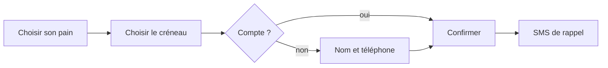

# Site Maison Pain

Site vitrine de la boulangerie, avec réservation du pain la veille et retrait en boutique. Client : [[Maison Pain]].

> [!tip] Objectif
> Un site rapide, lisible sur un téléphone, qu'Hélène met à jour seule (horaires, pain du jour).

## Étapes

- [x] Atelier de lancement avec Hélène ✅ {{J-20}}
- [x] [[Moodboard]] validé ✅ {{J-12}}
- [ ] Maquette de la page d'accueil 📅 {{J+1}} ⏫ #maison-pain
- [ ] Rédiger les textes « La maison » et « Nos pains » ⏳ {{J+3}} 📅 {{J+7}} #maison-pain
- [ ] Brancher la réservation 🛫 {{J+8}} 📅 {{J+20}} 🔼 #maison-pain
- [ ] Mettre en ligne 📅 {{J+30}} #maison-pain

## Pages

| Page | État | Responsable |
| --- | --- | --- |
| Accueil | maquette | Camille |
| Nos pains | textes à écrire | Hélène |
| Commander | à faire | Camille |
| La maison | photos à faire | Hélène |
| Contact | prête | Camille |

Le plan du site est dessiné dans [[Arborescence.excalidraw|Arborescence]] ; le détail est dans le [[Cahier des charges]], notamment sa partie [[Cahier des charges#Réservation|réservation]].

## Parcours de commande

## Décision du lancement

![[Lancement#^paiement]]

## Sous-pages

- [[Cahier des charges]]
- [[Moodboard]]
- [[Arborescence.excalidraw|Arborescence]]
- [[Lancement]]
- [[Présentation de la maquette]]
