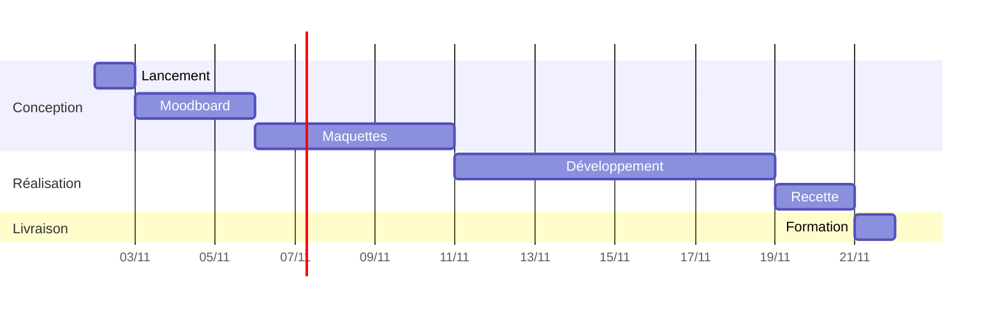
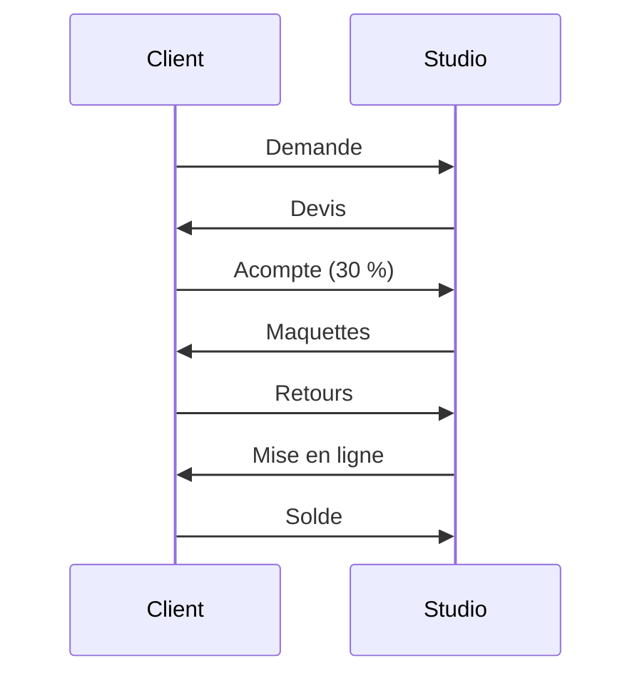

# Processus projet

Comment se déroule un projet, du premier appel à la mise en ligne.

## Les étapes

```flow
st=>start: Premier appel
op1=>operation: Atelier de lancement
op2=>operation: Moodboard
cond1=>condition: Validé ?
op3=>operation: Maquettes
cond2=>condition: Validées ?
op4=>operation: Développement
e=>end: Mise en ligne

st->op1->op2->cond1
cond1(yes)->op3->cond2
cond1(no)->op2
cond2(yes)->op4->e
cond2(no)->op3
```

## Planning type d'un site vitrine



## Échanges avec le client



> [!example] Modèles
> Les réunions se notent avec le modèle [[Réunion]], les comptes rendus avec [[Compte rendu]].
