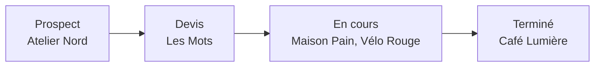

---
flownote-dashboard:
  Objectifs 2026: [0, 0, 4, 9]
  Chiffre d'affaires: [4, 0, 8, 9]
  Clients: [0, 9, 12, 10]
  Cette semaine: [0, 19, 5, 9]
  Pipeline: [5, 19, 7, 9]
  Logo Vélo Rouge: [0, 28, 6, 10]
  Arborescence: [6, 28, 6, 10]
---
## Objectifs 2026

- [x] Passer le TJM à 520 €
- [ ] 60 000 € de chiffre d'affaires
- [ ] Deux identités visuelles
- [ ] Un mois de vacances

## Chiffre d'affaires

```plotly
data:
  - type: bar
    name: 2026
    x: [Juil., Août, Sept., Oct.]
    y: [2100, 900, 6400, 5600]
  - type: bar
    name: 2025
    x: [Juil., Août, Sept., Oct.]
    y: [3100, 1200, 4800, 4300]
layout:
  title: Les quatre derniers mois (€ HT)
  barmode: group
```

## Clients

![[Clients.base]]

## Cette semaine

| Jour | Quoi |
| --- | --- |
| Demain | Maquette Maison Pain |
| Dans 2 jours | Présentation à Hélène |
| Dans 4 jours | Pistes de logo Vélo Rouge |
| Dans 5 jours | Rendez-vous Atelier Nord |

## Pipeline



## Logo Vélo Rouge

![[Pistes de logo.mindmap.md]]

## Arborescence

![[Arborescence.excalidraw.md]]
