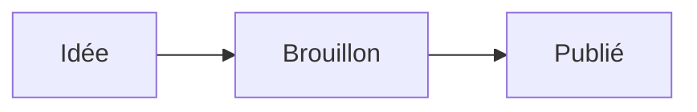

# Documentation de FlowNote

FlowNote édite votre vault Obsidian par blocs, avec un menu `/`, des bases, des dessins, des tickets, des présentations… Chaque page reste un fichier texte que vous pouvez continuer à ouvrir dans Obsidian et à versionner avec Git.

![[editeur.webp]]

[TOC]

## Les principes

> [!tip] Vos fichiers restent à vous
> - Une note que vous n'avez pas modifiée est réécrite **à l'octet près**. Une note modifiée ne change que dans les blocs touchés : un diff Git ne montre que vos modifications.
> - Rien n'est caché dans une base de données : tout est du Markdown, du YAML ou du JSON lisible.
> - Le dossier `.obsidian` n'est jamais modifié. FlowNote y lit seulement les réglages des liens et des pièces jointes.
> - Une note modifiée ailleurs (Obsidian, Git) n'est jamais écrasée : l'écriture est refusée et la différence est signalée.

## Prendre en main

1. **Ouvrez un vault** : au lancement, « Ouvrir un vault Obsidian… » et choisissez son dossier. Un dossier sans `.obsidian` convient aussi : il devient un vault. « Essayer avec un exemple » ouvre un vault de démonstration, en mémoire, sans rien écrire sur le disque.
2. **Créez une page** avec `⌘N` (ou le bouton en haut de la barre latérale) et choisissez son type : note, base, dessin, mind map, canevas, ticket, présentation ou dashboard.
3. **Écrivez** : le texte se tape directement, `/` ouvre le menu des blocs, `[[` insère un lien vers une autre note.
4. **Retrouvez une page** avec `⌘P`, ou un mot dans tout le vault avec `⌘⇧F`.
5. **Tout s'enregistre seul** : la pastille en bas à droite indique « Enregistré ». Le fichier est lisible tel quel dans Obsidian.
6. **Une commande dont vous ne connaissez pas le raccourci** : `⌘⇧P` ouvre la palette de commandes.

Le vault de démonstration est le carnet de Camille, qui crée des sites et des identités visuelles à son compte : des clients, des projets, des réunions, un journal, des voyages. Il montre tout ce que FlowNote sait faire, en situation. Sa note **« Bienvenue »** (dans les favoris) dit où voir chaque fonctionnalité : le projet « Site Maison Pain » et ses sous-pages (cahier des charges, moodboard, croquis, présentation), la base « Clients » et ses quatre vues, le dashboard, le canevas, les tarifs (maths, admonitions), la comptabilité (graphiques, Dataview, Tasks), les tickets, la liste de tâches et les lectures.

L'**Accueil** rassemble les raccourcis de création, les pages récentes, les tâches à faire (échéances des tickets et des notes), les tickets ouverts, les liens à lire et l'état de Git. Un clic sur un tag de la carte Vault liste les pages qui le portent (dans le texte ou dans la propriété `tags`).

![[accueil.webp]]

## L'interface

### La barre latérale

- **Le vault** en haut : son menu permet de passer en un clic à un vault ouvert récemment, d'en ouvrir un autre ou d'ouvrir les réglages. Le bouton à droite crée une page (`⌘N`).
- **Accueil**, **Rechercher** (`⌘P`), **Rechercher dans les notes** (`⌘⇧F`), **Tickets**, **Tâches**, **Révisions**, **Lectures**, **Graphe** et **Documentation** (cette page). Quand une page est ouverte, Accueil, Tickets, Tâches, Révisions, Lectures et Graphe s'ouvrent dans un nouvel onglet pour ne pas la remplacer.
- **Favoris** : les fichiers mis en favoris dans Obsidian.
- **Pages** : l'arbre du vault. Une note et le dossier du même nom (`Projets.md` + `Projets/`) forment une page avec ses sous-pages. Le dossier des tickets, la note des lectures et celle des tâches n'y figurent pas : ils ont leur propre vue.
  - Menu « … » ou clic droit : ouvrir dans un nouvel onglet, ouvrir à droite, sous-page, copier le lien, dupliquer, afficher dans le Finder, renommer, supprimer.
  - Glisser-déposer des pages et des dossiers : les liens qui pointent vers eux sont mis à jour à chaque déplacement.
- **Tags** : sous les pages, les tags du vault en arbre (`#projet/site` sous `#projet`), avec le nombre de notes qui portent chacun (tags imbriqués compris). Un clic ouvre la recherche dans les notes, filtrée sur ce tag. Un clic sur le titre « Tags » ouvre ou replie la section.
- En bas : **Git** (`⌘⇧G`), **Réglages** (`⌘,`) et **Aide et raccourcis** (`⌘/`).
- `⌘\` masque la barre latérale ; elle réapparaît au survol du bord gauche.

### La palette de commandes

`⌘⇧P` (ou `>` tapé en premier dans la recherche de pages `⌘P`) ouvre la liste de toutes les actions de l'app, par leur nom : ouvrir une vue, créer une page de chaque type, gérer les onglets, changer de thème, afficher les modifications dans la marge, exporter, passer en mode lecture ou en Markdown brut… Tapez quelques lettres, dans n'importe quel ordre et sans accents (`theme sombre` trouve « Thème sombre »), puis `↵`. Le raccourci de chaque commande s'affiche à droite ; les commandes utilisées récemment viennent en tête. Celles qui concernent une page n'apparaissent que si une page est ouverte.

### La barre de page

Au-dessus de chaque page : le fil d'Ariane (cliquable, avec le menu des dossiers), puis les actions de la page :

| Bouton | Action |
| --- | --- |
| Plan | les titres de la note, cliquables, dans une colonne à droite |
| Mode lecture `⌘⇧R` | la page se lit sans pouvoir être modifiée : ni curseur, ni correcteur, ni poignées ; les liens et les cases à cocher restent cliquables (retenu pour chaque onglet et chaque côté du split view) |
| Correction | active ou coupe le correcteur |
| Présentation | transforme la note en présentation (sur une présentation : miniatures, Présenter, export HTML) |
| Historique | les versions Git de la note, à comparer ou restaurer |
| Pleine largeur | la page occupe toute la fenêtre (retenu pour chaque page) |
| Mode focus `⌘⇧M` | masque tout sauf la page |
| « … » | export PDF, export HTML |
| Markdown brut `⌘⇧E` | le fichier tel quel, avec ses numéros de ligne |

- **Plan** et **Historique** s'affichent dans une même colonne à droite, le plan au-dessus.
- La **pastille d'état** en bas à droite indique l'enregistrement, le nombre de mots (temps de lecture au survol) et les mots de la sélection.

### Les onglets

Chaque page s'ouvre dans un onglet : `⌘T` nouvel onglet, `⌘W` fermer, `⌘1` … `⌘9` aller à un onglet, `⌘⇧[` / `⌘⇧]` onglet précédent / suivant, `⌘-clic` ouvrir dans un nouvel onglet. Les onglets se réordonnent par glisser-déposer. `⌘[` et `⌘]` reviennent à la page précédente ou suivante de l'onglet. Les onglets d'un vault (pages, page de droite, mode lecture) sont retrouvés au prochain lancement ; une page supprimée entre-temps disparaît de la liste.

### Deux pages côte à côte

`⌥-clic` sur une page de la barre latérale (ou « Ouvrir à droite » dans son menu) l'affiche à droite de la page active. Les deux pages forment **un seul onglet**, qui porte leurs deux noms.

![[split-view.webp]]

- Clic droit sur un autre onglet : « Afficher à droite de… » ; sur l'onglet actif : « Diviser avec l'onglet suivant ».
- Clic droit sur l'onglet double : échanger les côtés, séparer en deux onglets, fermer la page de droite. Fermer l'onglet ferme les deux.
- La page de droite a la même barre d'outils que celle de gauche, plus trois boutons : ouvrir dans son propre onglet, échanger les côtés, fermer.
- Comme à gauche, « Ajouter une icône » s'affiche au survol au-dessus de son titre.
- Le séparateur se déplace à la souris (la largeur est retenue). `⌘⌥\` ouvre ou ferme le panneau de droite.
- Les deux côtés s'enregistrent chacun de leur côté. Une page ouverte des deux côtés ne se modifie qu'à gauche.

### Les réglages

Ouverts dans un onglet (`⌘,`) et rangés par catégorie :

- **Général** : apparence (système, clair, sombre), taille de l'interface (petite, normale, grande, très grande), police (celle du système, **Clarika**, douce et arrondie, **Open Sans** ou **Inter**), enregistrement automatique.
- **Éditeur** : correcteur (Grammalecte, celui de macOS, ou aucun) ; menu des blocs en **liste** (avec les descriptions) ou en **grille** d'icônes, plus compacte (le nom de chaque bloc au survol, les flèches dans les deux sens) ; modifications depuis le dernier commit dans la marge (désactivé par défaut, voir Git).
- **Tickets** : dossier des tickets et colonnes du tableau.
- **Lectures** : note des lectures et lecture automatique du titre des liens.
- **Vault** : changer de vault.

![[reglages.webp]]

## L'éditeur de notes

### Le titre

Une page a un **titre** et un **nom de fichier**, indépendants :

- **Le titre** s'affiche en haut de la page ; cliquez dessus pour le modifier. Pour une note, c'est sa première ligne `# Titre` (ajoutée si besoin) ; pour une présentation, sa propriété `title`. Le modifier ne renomme jamais le fichier.
- **Le nom du fichier** s'affiche en gris sous le titre (`Réunion.md`) : cliquez dessus pour renommer le fichier. On renomme aussi depuis la barre latérale ou le fil d'Ariane.
- Une nouvelle note commence par `# Nom` : titre et nom sont égaux au départ. C'est vrai aussi d'une sous-page créée par `/sous-page`, rangée dans le dossier de la note et liée depuis elle.
- Le bouton **T** de la section « Pages » de la barre latérale choisit d'afficher les titres ou les noms de fichier, dans la barre latérale et les onglets ; l'autre s'affiche au survol.

### Les blocs

Tapez `/` en début de ligne pour insérer ou transformer un bloc : texte, titres, listes, tâches, toggle, citation, callouts, admonition HedgeDoc, sous-page, code, Mermaid, organigramme, graphique, bloc de maths, formule en ligne, tableau, séparateur, sommaire, date… Continuez à taper pour filtrer, `↵` pour choisir.

![[menu-slash.webp]]

Les raccourcis Markdown marchent aussi à la frappe :

| Tapez | Pour obtenir |
| --- | --- |
| `#`, `##`, `###` puis espace | un titre |
| `-` ou `*` puis espace | une liste à puces |
| `1.` puis espace | une liste numérotée |
| `[]` puis espace | une tâche |
| `>` puis espace | une citation |
| `> [!note]` puis espace | un callout Obsidian |
| `:::info` puis espace | une admonition HedgeDoc |
| ```` ``` ```` puis espace | un bloc de code (```` ```py ```` propose les langages : `↵` en choisit un) |
| `$$` puis espace | un bloc de maths |
| `$x^2$` | une formule en ligne |
| `---` | un séparateur |

**La poignée** apparaît à gauche du bloc survolé : `+` ajoute un bloc dessous (refermé sans choix, par `esc` ou un clic ailleurs, le menu ne laisse rien : ni `/`, ni ligne vide), `⋮⋮` le déplace par glisser-déposer (aussi pour l'imbriquer dans une liste) et ouvre son menu (supprimer, dupliquer, monter, descendre, transformer). En pleine largeur, la marge étant étroite, `+` s'affiche au-dessus de `⋮⋮`.

![[poignee.webp]]

- `⌥↑` / `⌥↓` déplacent le bloc, `⌘D` le duplique.
- `↵` en fin de liste vide en sort ; `⇧↵` passe à la ligne dans le même bloc.
- `⇥` indente : dans une liste, l'élément passe sous celui du dessus ; dans un paragraphe, la ligne devient un élément de liste, rangé sous la liste du dessus s'il y en a une (Markdown n'a pas de texte indenté : quatre espaces en feraient du code). `⇧⇥` désindente.
- **Niveau d'un titre** : curseur dans un titre, ses `#` s'affichent en gris au début de la ligne. Au début du titre, `⌫` en retire un (un titre 1 redevient du texte) et `#` en ajoute un. Son niveau s'affiche aussi dans la marge à gauche : un clic ouvre la liste des niveaux (titre 1 à 6, ou texte), aussi `⌘⌥1` … `⌘⌥6` et `⌘⌥0`.
- **Replier une section** : au survol d'un titre, une flèche apparaît à sa gauche ; un clic replie tout ce qui suit jusqu'au titre suivant de même niveau (« … » après le titre), un second le déplie. Seul l'affichage change, rien n'est écrit dans le fichier, et tout est déplié à la prochaine ouverture de la note. Un curseur qui arrive dans une section repliée (recherche, annulation) la déplie.
- `⌫` au début d'une ligne la remonte au bout de la ligne du dessus, même sous une liste, une citation ou un callout. Sous un tableau, le curseur va dans la dernière cellule ; sous un séparateur, celui-ci est sélectionné (un second `⌫` le supprime).

### La mise en forme

- **Barre de mise en forme** : sélectionnez du texte, une barre apparaît au-dessus, alignée sur le début de la sélection (elle ne bouge pas pendant qu'on s'en sert) : gras, italique, souligné, barré, fluo (et sa couleur, flèche à droite), code, lien, note de bas de page (une petite fenêtre demande son texte ; l'appel se place après la sélection, qui reste intacte) et gomme, qui retire la mise en forme (les liens restent).
- `⌘B` gras, `⌘I` italique, `⌘U` souligné, `⌘E` code, `⌘⇧S` barré, `⌘⇧H` fluo. Les délimiteurs Markdown (`**gras**`, `*italique*`, `~~barré~~`, `==fluo==`) marchent aussi à la frappe. Markdown n'a pas de souligné : il s'écrit `<u>souligné</u>`, comme dans Obsidian.
- **Fluo en couleur** : un emoji de couleur juste après `==` (`==🟢vert==`, `==🔴rouge==`, `==🔵bleu==`, `==🟡jaune==`, `==🟣violet==`). Le curseur dans un fluo, un petit crayon apparaît à son début : un clic choisit une autre couleur (ou « Défaut », le jaune sans emoji). Obsidian affiche l'emoji dans un fluo jaune.
- **Code en ligne** : `` ` `` tapé sur une sélection la met entre accents graves ; posé devant puis derrière un mot (ou l'inverse), le mot devient du code. Curseur dans le code, ses `` ` `` s'affichent en gris : `→` à la fin passe le `` ` `` fermant, puis `⌫` retire le code (le texte reste) ; `⌦` avant le `` ` `` ouvrant, ou `⌘E` dans le code, le retire aussi.
- **Emoji** : `:` suivi d'un mot propose un emoji, écrit `:shortcode:` dans le fichier. Un code tapé à la main (`:white_check_mark:`) s'affiche en emoji dès son `:` fermant. Comme pour le fluo et le code, `←` juste après l'emoji (ou un clic dessus) montre son code pour le modifier ; il redevient un emoji quand le curseur en sort. `⌫` juste après l'efface en entier.

### Les liens

- `[[` insère un lien vers une note, avec autocomplétion ; `![[` intègre une note, une image ou une base. Les liens suivent les réglages d'Obsidian.
- **Alias** : une note trouve aussi par ses `aliases` (propriété). Choisie par un alias, elle est liée sous ce nom : `[[Projets|Chantiers]]`.
- **Lier un titre ou un bloc** : après le nom de la note, `#` liste ses titres (`[[Tarifs#Prestations]]`) et `#^` ses paragraphes et éléments de liste (`[[Tarifs#^kg8i75]]`). Un bloc choisi qui n'a pas encore d'identifiant en reçoit un, écrit à la fin de sa ligne (` ^kg8i75`), comme dans Obsidian : seule cette ligne change. `[[#` liste les titres et `[[#^` les blocs de la note elle-même. Ces liens s'affichent « Tarifs › Prestations ».
- **Copier le lien vers un bloc** : menu de la poignée `⋮⋮` d'un paragraphe ou d'un élément de liste (l'identifiant est ajouté s'il manque), ou « Copier le lien vers ce titre » sur un titre. Les identifiants s'affichent en gris dans la note.
- **Renommer un titre** met à jour les liens qui pointent vers lui dans les autres notes (`[[Note#Ancien titre]]` devient `[[Note#Nouveau titre]]`), à l'enregistrement, comme Obsidian (une petite note dit combien). Seule la page affichée à droite, en cours de modification, est laissée telle quelle.
- `⌘K` sur un texte sélectionné demande l'adresse d'un lien web ; sur un lien existant, il le modifie ou le retire. Coller une URL sur un texte sélectionné en fait aussi un lien. Une adresse tapée (`https://…`, `www.…`) devient un lien dès qu'on la quitte ; le fichier garde l'adresse telle quelle.
- Un **clic** sur un lien l'ouvre : dans le navigateur pour une adresse web, dans l'app pour une note. Un **clic molette** l'ouvre dans un nouvel onglet. Au **survol**, une barre affiche l'adresse avec Modifier, Copier et Retirer.
- Coller ou déposer une image l'enregistre dans le dossier des pièces jointes réglé dans Obsidian et l'intègre à la note. Sans réglage (ou réglé sur la racine du vault), l'image va dans un dossier `attachments` à côté de la note.
- La syntaxe Markdown tapée à la main devient un lien ou une image dès la parenthèse fermante : `[texte](https://…)` pour un lien, `` pour une image (du web ou du vault). Du texte simple collé (depuis un fichier texte, un terminal ou le mode source d'Obsidian) est lu comme du Markdown ; ce qui est copié d'une page web garde sa mise en forme. Un **seul bloc** collé (une ligne, un titre ou un élément de liste copié d'une page web) n'apporte que son texte (gras, liens…) : la ligne où il arrive garde son type, un paragraphe ne devient ni un titre ni une puce. Plusieurs blocs gardent les leurs.

### Les modèles

Si un dossier de modèles est réglé dans Obsidian (module « Modèles », `.obsidian/templates.json`), ses notes servent de modèles :

- **Nouvelle page** (`⌘N`), type Note : le menu **Modèle** propose « Aucun » ou un modèle. La page part du modèle, sous son titre `# Nom` (après les propriétés du modèle).
- **`/modèle`** dans une note : une fenêtre liste les modèles ; celui choisi remplace la ligne vide du curseur (ou s'insère sous la ligne), sans ses propriétés.

Dans le modèle, `{{title}}` devient le titre de la note, `{{date}}` et `{{time}}` la date et l'heure aux formats réglés dans Obsidian. Un format peut s'écrire sur place, avec les codes d'Obsidian : `{{date:dddd D MMMM}}` donne « lundi 26 octobre ».

```markdown
---
tags: [réunion]
---

Le {{date}} à {{time}}.

## Ordre du jour
```

Sans dossier de modèles réglé dans Obsidian, ni le menu ni `/modèle` n'apparaissent. Le vault de démo en a un, avec « Réunion », « Compte rendu » et « Journal ».

### Intégrer une note

Avec la syntaxe d'Obsidian, `![[…]]` affiche le contenu d'une autre note dans la page, en lecture, toujours à jour : modifiez la note d'origine, l'intégration suit. Un clic sur le titre de l'intégration ouvre la note. `/intégrer` insère `![[` et propose les notes.

```markdown
![[Réunion]]                 la note entière (sans ses propriétés)
![[Réunion#Décisions]]       une section : le titre et ce qui suit jusqu'au titre suivant de même niveau
![[Réunion#Plan#Budget]]     une sous-section (« Budget » sous « Plan »)
![[Réunion#^choix-date]]     un seul bloc, marqué ^choix-date dans la note d'origine
```

Pour intégrer un bloc, ajoutez un identifiant à la fin de sa ligne dans la note d'origine : ` ^choix-date` après un paragraphe, ou après un élément de liste (ses sous-éléments viennent avec). L'identifiant est masqué dans l'intégration.

```markdown
On garde le jeudi pour les réunions d'équipe. ^choix-date
```

Le fichier garde simplement `![[Réunion#Décisions]]` : Obsidian l'affiche de la même façon. Une note qui s'intègre elle-même (directement ou par une autre) s'arrête au troisième niveau.

### Les notes de bas de page

Un appel `[^1]` dans le texte, et le texte de la note `[^1]: …` plus bas, n'importe où dans la page : c'est la syntaxe d'Obsidian et du Markdown courant[^doc]. L'appel s'affiche en exposant ; survolez-le pour lire la note, cliquez pour y aller. Les notes s'affichent en bas avec leur numéro ; double-cliquez sur une note pour modifier son texte.

```markdown
FlowNote garde vos fichiers lisibles[^1].

[^1]: Même sans FlowNote, dans Obsidian ou un simple éditeur de texte.
```

Sur un texte sélectionné, le bouton **¹** de la barre de mise en forme demande le texte de la note, comme `⌘K` demande l'adresse d'un lien, puis place l'appel après la sélection. `/note de bas de page` ajoute un appel au curseur (le premier numéro libre) et sa note en fin de page, à compléter d'un double-clic. Les étiquettes peuvent être des mots (`[^source]`) ; une note peut tenir sur plusieurs lignes, les suivantes indentées.

### Les callouts et les admonitions

- **Callouts Obsidian** : `> [!note] Titre`. Cliquez sur l'icône pour changer le type (note, info, astuce, attention, danger…). Un toggle est un callout repliable (`> [!note]-`) : la flèche à sa gauche le replie ou le déplie (la poignée du bloc se place plus à gauche pour la laisser libre).
- **Admonitions HedgeDoc** : un bloc entre `:::type` et `:::` s'affiche comme un callout et garde sa syntaxe dans le fichier.

```markdown
> [!tip] Objectif
> Un site rapide, lisible sur mobile.

:::spoiler Cliquer pour voir
Un contenu replié.
:::
```

Types reconnus par HedgeDoc : `success`, `info`, `warning`, `danger` et `spoiler` (replié, ouvert avec `{state="open"}`). Rendu :

:::success
Une admonition `success`, écrite `:::success` dans le fichier.
:::

### Les propriétés

Les propriétés YAML (le frontmatter) s'affichent sous le titre : texte, liste, nombre, case à cocher, date, date et heure. Les tags s'affichent en pastilles, même écrits sur une ligne (`tags: projet, site`) ; les modifier les réécrit en liste YAML. Sur une note sans propriétés, « Ajouter des propriétés » en crée une. Les dates se choisissent dans le calendrier de l'app (tapez aussi `jj/mm/aaaa`).

L'icône de la page est un emoji choisi au-dessus du titre. Dans le fichier :

```yaml
---
icon: 🚀
tags: [projet, site]
statut: en cours
---
```

### Les blocs spéciaux

- **Tableaux** : `/tableau` demande d'abord sa taille : survolez la grille et cliquez, ou tapez le nombre de lignes (en-tête comprise) et de colonnes, puis **OK**. Poignées de lignes et de colonnes pour insérer, déplacer, aligner ou supprimer. `Tab` passe à la cellule suivante, `↵` à celle du dessous.
- **Code** : coloration syntaxique, langage choisi en haut du bloc (la liste des langages s'affiche dès la première lettre) ; `⌘↵` ou trois `↵` en sortent.
- **HTML** : le HTML écrit dans une note s'affiche mis en page : un bloc (`<div>`, `<details>`, `<table>`…), du texte entouré (`<span style="…">`, `<sup>`, `<kbd>`…) ou une image (``, même du vault). Tapé dans la note, le HTML s'affiche dès que le curseur quitte la ligne (`<h3>Thaïlande</h3>` puis `↵`). Les scripts, cadres et formulaires sont retirés à l'affichage, jamais du fichier. Double-cliquez sur un bloc HTML pour modifier sa source.
- **Mermaid** : un bloc ```` ```mermaid ```` devient un diagramme (`/mermaid`) ; sa source s'affiche quand le curseur entre dans le bloc.
- **Organigrammes flowchart.js** : un bloc ```` ```flow ```` (comme HedgeDoc, ```` ```flowchart ```` aussi) est dessiné par [flowchart.js](https://flowchart.js.org) (`/organigramme`). On déclare les éléments (`st=>start: Début`, `op=>operation: …`, `cond=>condition: …`, `e=>end: Fin`), puis on les relie (`st->op->cond`, `cond(yes)->e`, `cond(no)->op`). Sans écrire de texte : **Éditeur visuel**, en haut du bloc, liste les étapes (forme et texte) et les flèches (départ, sortie oui/non d'une condition, arrivée, côté de départ). `↵` dans le texte d'une étape en ajoute une à la suite, insérée dans sa flèche. flowchart.js place les formes lui-même.
- **Graphiques Plotly** (`/graphique`) : au format du plugin obsidian-plotly, avec un éditeur visuel (type, titres, valeurs, import d'un CSV). L'éditeur visuel propose lignes, barres (verticales, horizontales, empilées), aire, points, camembert, anneau et radar ; tous les autres types de Plotly (heatmap, 3D, sankey…) s'affichent aussi et s'écrivent en texte.
- **Maths** : des formules LaTeX dessinées par [KaTeX](https://katex.org). En ligne, `$x^2$` tapé devient une formule au `$` fermant (pas d'espace juste à l'intérieur des `$`, ni de chiffre ou de lettre juste avant le premier : « 5$ et 10$ » reste du texte) ; un clic dessus ouvre une petite fenêtre avec sa source et l'aperçu en direct (`↵` valide, `esc` annule, vide la retire). En bloc, `$$` puis espace (ou `/maths`) ; un double-clic ouvre sa source, l'aperçu suit la frappe sous le champ, `⌘↵` ou un clic à côté valide. Une formule fautive s'affiche en rouge avec l'erreur. Le fichier garde `$…$` et `$$…$$` tels quels ; l'export HTML les écrit en MathML.
- **Sommaire** : un paragraphe `[TOC]` affiche les titres de la note, cliquables (comme en haut de cette page).
- **Date** : `/date` insère la date du jour (`/date et heure` avec l'heure).
- **Requêtes Dataview et Tasks** : voir le chapitre « Requêtes » plus bas.

Dans le fichier :

````markdown


La formule $E = mc^2$ en ligne, et en bloc :

$$
\sum_{k=1}^{n} k = \frac{n(n+1)}{2}
$$

```plotly
data:
  - type: bar
    x: [Janv., Févr., Mars]
    y: [12, 19, 7]
layout:
  title: Ventes
```
````

### Copier, rechercher, notes liées

- **Copier** : le texte copié depuis une note se colle en Markdown dans un éditeur de texte, et mis en forme dans un traitement de texte, avec ses images (pas seulement leur nom).
- **Rechercher** : `⌘F` dans la note, `⌘⌥F` pour remplacer, `⌘⇧F` dans tout le vault.
- **Filtres de la recherche** (`⌘⇧F`) : « + Filtre » restreint la recherche par tag (les tags imbriqués compris), dossier, propriété (une valeur, ou « est renseignée ») ou date de modification (aujourd'hui, 7 ou 30 derniers jours, cette année, ou une période). La syntaxe d'Obsidian marche aussi et devient des pastilles à l'espace ou à `↵`. Sans texte, la recherche liste les notes filtrées, les plus récemment modifiées d'abord. `⌫` dans le champ vide retire la dernière pastille. Par exemple :
  - `réunion tag:#projet` : « réunion » dans les notes qui portent le tag `#projet` (ou `#projet/site`) ;
  - `path:Projets budget` : « budget » dans le dossier `Projets` ;
  - `[statut:fait]` (sans texte) : les notes dont la propriété `statut` vaut « fait » ; `[statut]` : celles où elle est renseignée.
- **Notes liées** : sous chaque note, les pages qui pointent vers elle, avec la ligne du lien.

## Requêtes : Dataview et Tasks

FlowNote lit les blocs des deux plugins les plus utilisés d'Obsidian, **Dataview** et **Tasks**, et affiche leurs résultats sous le bloc. Les résultats viennent de tout le vault et se mettent à jour quand vous revenez sur la fenêtre. Cliquez dans le bloc pour voir et modifier sa requête ; `/dataview` et `/tasks` en insèrent un. Le fichier garde le bloc tel quel : Obsidian, avec le plugin, l'affiche de la même façon.

### Dataview

Un bloc ```` ```dataview ```` liste des notes selon leurs propriétés. Une requête commence par le type de résultat, puis des clauses dans cet ordre libre :

| Clause | Rôle | Exemple |
| --- | --- | --- |
| `LIST [expression]` | une liste de liens, avec une valeur après chacun | `LIST statut` |
| `TABLE col, col AS "Titre"` | un tableau, une colonne par expression | `TABLE pays, budget AS "Budget"` |
| `TABLE WITHOUT ID` | sans la colonne des notes | `TABLE WITHOUT ID file.name` |
| `TASK` | les tâches des notes, groupées par note | `TASK WHERE !completed` |
| `FROM` | où chercher : `#tag`, `"Dossier"`, `[[Note]]` (les notes qui y renvoient), combinés avec `and`, `or`, `-` | `FROM #projet and -"Archives"` |
| `WHERE` | une condition | `WHERE budget > 500` |
| `SORT` | l'ordre, `ASC` ou `DESC` | `SORT file.mtime DESC` |
| `GROUP BY` | des groupes par valeur | `GROUP BY statut` |
| `LIMIT` | le nombre de résultats | `LIMIT 10` |

````markdown
```dataview
TABLE pays AS "Pays", depart AS "Départ", budget
FROM "Voyages"
WHERE budget < 2000
SORT depart ASC
```

```dataview
LIST
FROM #projet
WHERE file.mtime >= date(today) - dur(7 days)
```
````

**Les champs** : les propriétés de la note (`statut`, `budget`…), les champs écrits dans le texte sous la forme `Responsable:: [[Léa]]` (ou `[due:: 2026-11-01]` dans une phrase), et ceux du fichier : `file.name`, `file.path`, `file.folder`, `file.link`, `file.tags`, `file.ctime`, `file.mtime`, `file.tasks`, `file.outlinks`. `this` désigne la note qui contient la requête (`WHERE file.name != this.file.name`).

**Les expressions** : comparaisons (`=`, `!=`, `<`, `>`, `<=`, `>=`), `and`, `or`, `!`, calculs (`budget * 2`), dates (`date(today)`, `date(2026-10-01)`, `date(tomorrow)`, `sow`/`eow` pour la semaine) et durées (`dur(7 days)`, `dur(2 weeks)`). Fonctions : `contains`, `icontains`, `length`, `lower`, `upper`, `default`, `choice`, `round`, `startswith`, `endswith`, `regexmatch`, `join`, `min`, `max`, `sum`.

**Les tâches** (`TASK`) : `completed`, `text`, `due`, `scheduled`, `completion`, `tags`, `section` (le titre au-dessus).

Ne sont pas exécutés : les blocs `dataviewjs` (JavaScript), les requêtes en ligne (`` `= this.file.name` ``) et `FLATTEN` ; un message l'indique sous le bloc.

### Tasks

Une tâche est une case à cocher Markdown ; le plugin Tasks y ajoute des dates et une priorité par des signes, que FlowNote lit :

```markdown
- [ ] Envoyer le devis #client 📅 2026-10-30 ⏫
- [ ] Relire le contrat ⏳ 2026-10-24 🛫 2026-10-23
- [ ] Faire le point 🔁 every week 📅 2026-10-28
- [x] Réserver la salle ✅ 2026-10-20
```

📅 échéance, ⏳ date prévue, 🛫 date de début, ✅ date de fin, 🔁 répétition ; 🔺 ⏫ 🔼 🔽 ⏬ priorité de la plus haute à la plus basse. Le format de Dataview (`[due:: 2026-10-30]`) est lu aussi. Dans une tâche, `/échéance` ajoute `📅` et la date choisie.

Un bloc ```` ```tasks ```` rassemble les tâches de tout le vault, une instruction par ligne (toutes doivent être vraies) :

````markdown
```tasks
not done
due before in 7 days
path includes Projets
sort by due
```
````

| Instruction | Exemples |
| --- | --- |
| état | `done`, `not done` |
| dates | `due today`, `due before tomorrow`, `due after 2026-11-01`, `due this week`, `scheduled on or before today`, `done last week`, `due in 3 days`, `due 2 days ago` |
| présence d'une date | `has due date`, `no due date` (aussi `scheduled`, `start`, `done`) |
| texte | `path includes Projets`, `filename includes Réunion`, `description includes devis`, `heading includes À faire` (et `does not include`) |
| tags | `tag includes #client`, `tags do not include #perso` |
| priorité | `priority is high`, `priority is above none` |
| répétition | `is recurring`, `is not recurring` |
| combinaisons | `(due today) OR (priority is high)`, `NOT (done)` |
| tri | `sort by due`, `sort by priority`, `sort by path`, … ajoutez `reverse` pour l'inverse |
| groupes | `group by filename`, `group by folder`, `group by due`, `group by priority` |
| nombre | `limit 10` |

Les résultats montrent chaque tâche avec ses dates (l'échéance en rouge si elle est passée) et sa note. **Cocher une tâche dans les résultats la coche dans sa note** : seule sa ligne change (`[x]` et `✅ date du jour`, comme le plugin). Une tâche de la note ouverte se coche dans la note elle-même. Une tâche répétée (🔁) cochée ne crée pas l'occurrence suivante.

## Les types de page

À la création d'une page (`⌘N`), choisissez son type. Tous restent des fichiers lisibles par Obsidian et ses plugins.

### Bases

Des bases de données au format des Bases d'Obsidian (`Voyages.base`). Chaque ligne est une note du dossier du même nom (`Voyages/`), chaque colonne une propriété YAML de ces notes.

![[base-tableau.webp]]

- Vues **Tableau**, **Kanban**, **Galerie** et **Calendrier**, en onglets au-dessus de la base, avec filtres, tris et groupes.
- **Calculs** en bas des colonnes (somme, moyenne, remplies, vides…) et **formules**.
- Sélections colorées, cellules date avec le calendrier de l'app, saisie au clavier, glisser-déposer des colonnes, des lignes et des cartes.
- **Saisie** : dans une cellule de texte, les valeurs déjà utilisées dans la colonne sont proposées sous le champ (`↑` `↓` puis `↵`, ou un clic). Les adresses web et les `[[liens]]` écrits dans une cellule sont cliquables ; une adresse longue s'affiche sur une ligne, tronquée (l'adresse entière au survol).
- **Filtres** : la colonne, la condition et la valeur se choisissent dans des menus ; la valeur propose celles de la colonne (options d'une sélection, valeurs déjà saisies). Un filtre sans valeur ne masque encore rien.
- **Colonne Nom** : chaque ligne est une note, cette colonne est son nom de fichier. Elle ne se supprime pas, mais se renomme dans son menu (le nom est gardé dans la base, `displayName`, comme dans Obsidian).
- **Renommer la base** : son nom, en haut, se modifie en place (`↵` valide, `esc` annule). Le dossier de ses lignes est renommé avec elle, et les liens suivent.
- **Ouvrir une ligne** : un clic sur son nom (ou sur une carte, une entrée du calendrier) l'ouvre dans un nouvel onglet, la base reste ouverte. Depuis la note, le fil d'Ariane ramène à la base (le dossier des lignes y mène).
- **Menu d'une ligne** : clic droit sur la ligne, ou clic sur sa poignée `⋮⋮` (qui sert aussi à la glisser) : ouvrir dans un nouvel onglet ou ici, renommer ou supprimer sa note (après confirmation, vers la corbeille dans l'app de bureau).
- « Nouveau » crée une note dans le dossier de la base.
- Une base s'intègre dans une note avec `![[Voyages.base]]`.

Le kanban groupe les lignes par une propriété (ici `statut`) ; glisser une carte change sa valeur :

![[base-kanban.webp]]

Le calendrier place les lignes selon une propriété date :

![[base-calendrier.webp]]

Dans le fichier, une base est du YAML qu'Obsidian lit tel quel (FlowNote garde les clés qu'il ne connaît pas) :

```yaml
filters:
  and:
    - file.inFolder("Voyages")
views:
  - type: table
    name: Tableau
  - type: kanban
    name: Kanban
    groupBy:
      property: note.statut
      direction: ASC
```

### Tickets

Un ticket est une note du dossier des tickets (`Tickets/1 - Exporter en PDF.md`), avec un état, des tags, une échéance, des tâches et un fil de commentaires.

![[ticket.webp]]

La vue **Tickets** les liste (ouverts ou fermés, tri par échéance, date ou numéro, recherche, filtre par tag) :

![[tickets-liste.webp]]

…ou les range en **tableau kanban**, avec glisser-déposer entre les colonnes. Le bouton **Colonnes** personnalise les colonnes (aussi dans les réglages).

![[tickets-tableau.webp]]

Dans le fichier, l'état et l'échéance sont des propriétés, les commentaires des callouts :

```markdown
---
type: ticket
id: 1
status: open
tags: [idée, export]
due: 2026-10-18
---

Pouvoir exporter une note en PDF depuis la barre d'outils.

## Commentaires

> [!comment] 14/10/2026 09:12
> Bonne idée, à prévoir pour la prochaine version.
```

### Dessins

Des dessins à main levée avec Excalidraw, au format du plugin Obsidian « Excalidraw » (`Croquis.excalidraw.md`). Les outils prennent place dans la barre de page ; le clic droit ouvre le menu des formes (copier, styles, plans, verrouiller…).

![[croquis.webp]]

### Mind maps

Des cartes mentales (`Idées.mindmap.md`) : `Tab` ajoute un enfant, `↵` un frère, double-clic renomme, glisser réorganise ; les boutons à gauche règlent la disposition, ceux en bas à droite le zoom. La barre de page recentre la carte et l'exporte en PNG. Le fichier garde aussi la carte en liste Markdown, lisible sans FlowNote :

````markdown
# Mind map

- Site web
  - Contenu
  - Design
%%
```json
{ "nodeData": { "id": "root", "topic": "Site web", "children": […] } }
```
%%
````

![[mindmap.webp]]

### Canevas

Le tableau blanc d'Obsidian (`Plan.canvas`) : des cartes posées librement et reliées par des flèches.

- **Ajouter** avec la barre du bas : une carte de texte (Markdown), une note ou une image du vault (son contenu s'affiche dans la carte ; un clic sur son titre l'ouvre dans un nouvel onglet), un lien web (dans l'app de bureau, la carte montre le titre et l'image d'aperçu de la page ; une vidéo YouTube montre sa miniature, ▶ la lit dans la carte), un groupe. Un double-clic sur le fond crée une carte de texte à cet endroit.
- **Écrire** : double-clic dans une carte de texte ; `esc` ou un clic à côté pour finir.
- **Relier** : tirer depuis un des points qui apparaissent au bord d'une carte jusqu'à une autre. Double-clic sur une flèche pour lui donner un libellé.
- **Organiser** : glisser les cartes (un groupe emporte les cartes qu'il contient), les redimensionner par leurs poignées, les colorer, les grouper ou les supprimer avec la barre qui apparaît en haut quand une carte ou une flèche est sélectionnée.
- Les flèches de la barre du bas, ou `⌘Z` / `⌘⇧Z`, annulent et rétablissent ; la molette ou le pavé déplace le tableau, les boutons en bas à gauche zooment et recadrent.

Le fichier est écrit exactement comme Obsidian l'écrit : un canevas modifié dans les deux applications donne des diffs propres dans Git. C'est du JSON (format JSON Canvas) : des cartes avec leur position, leur taille et leur contenu, et des flèches entre elles.

```json
{
	"nodes":[
		{"id":"8c3f1a7e2b6d4091","x":0,"y":0,"width":250,"height":60,"color":"4","type":"text","text":"## Objectif"},
		{"id":"2e9b4d7c1a8f3065","x":360,"y":0,"width":400,"height":400,"type":"file","file":"Projets/Site web.md"}
	],
	"edges":[
		{"id":"c4e7a0d3f6b91825","fromNode":"8c3f1a7e2b6d4091","fromSide":"right","toNode":"2e9b4d7c1a8f3065","toSide":"left","label":"suivi dans"}
	]
}
```

### Présentations

Une note avec `marp: true` devient une présentation Marp : diapos séparées par `---`, notes de l'orateur en commentaires, miniatures à jour à côté du texte, mode Présenter (`⌘⌥P`) et export HTML ou PDF. « Transformer en présentation » dans la barre de page convertit une note existante.

```markdown
---
marp: true
title: Bilan du trimestre
---

# Bilan du trimestre

---

## Chiffres clés

- Ventes : +12 %
<!-- Note de l'orateur : insister sur le second mois. -->
```

![[presentation.webp]]

### Dashboard

« Nouveau dashboard » crée `Nom.dashboard.md` : une grille de widgets sur 12 colonnes. Chaque widget est une section `## Titre` de la note, écrite en Markdown normal.

- **Ajouter** : « Ajouter un widget », fixé en haut à droite, propose un texte, un tableau, un graphique Plotly (à modifier avec son éditeur visuel), un diagramme Mermaid, ou une mind map, un croquis Excalidraw ou une base du vault (existants ou nouveaux). Ces trois derniers s'intègrent par `![[…]]`, le titre au-dessus les ouvre.
- **Déplacer** : glisser le widget par sa barre de titre, n'importe où sur toute la largeur de la page ; les widgets sur son chemin descendent.
- **Redimensionner** : tirer le bord droit (largeur), le bord bas (hauteur) ou le coin, case par case.
- **Modifier** : écrire directement dans le widget ; cliquer le titre pour le renommer ; la croix le supprime.

Les positions sont rangées dans les propriétés (`flownote-dashboard: { Titre: [x, y, largeur, hauteur] }`). Dans Obsidian, le fichier reste une note lisible, une section par widget. Une mind map ou un croquis intégré dans une note normale (`![[Idées.mindmap.md]]`) s'affiche aussi, en lecture. Exemple :

~~~~
---
flownote-dashboard:
  Budget: [0, 0, 8, 9]
  Idées: [8, 0, 4, 9]
---
## Budget

```plotly
data:
  - type: bar
    x: [A, B]
    y: [3, 5]
```

## Idées

![[Idées.mindmap.md]]
~~~~

### Kanban

Les tableaux du plugin **Kanban** d'Obsidian : une note qui porte `kanban-plugin: board` dans ses propriétés s'ouvre en colonnes. « Nouveau kanban » en crée un, avec trois listes.

- **Cartes** : « Ajouter une carte » au bas d'une liste (`↵` valide, `⇧↵` passe à la ligne) ; double-clic pour modifier une carte, vide pour la supprimer (ou la croix au survol). La case la coche.
- **Déplacer** : glisser une carte dans sa liste ou dans une autre. Une liste marquée `**Complete**` (comme « Fait ») coche les cartes qui y arrivent.
- **Listes** : double-clic sur un titre pour le renommer ; « Ajouter une liste » à droite ; une liste vide se supprime par sa croix.
- Dans les cartes, `[[liens]]` (cliquables), `#tags` et dates `@{2026-10-30}` s'affichent comme dans le plugin.

Le fichier est écrit comme le plugin l'écrit : un tableau non modifié reste identique à l'octet près, et seules les listes touchées sont réécrites ; l'archive et les réglages du plugin (`%% kanban:settings %%`) sont gardés tels quels.

```markdown
---

kanban-plugin: board

---

## À faire

- [ ] Maquettes mobiles pour [[Site Maison Pain]] @{2026-10-30}


## Fait

**Complete**
- [x] Devis signé
```

### Tâches

« Tâches » dans la barre latérale, la tuile « Nouvelle tâche » de l’accueil ou « Ouvrir les tâches » dans la palette (⌘⇧P) ouvre la liste de tâches : un titre, une catégorie, une échéance et des tags, puis « Ajouter ». Les tâches sont rangées par catégorie ; une échéance passée s'affiche en rouge, celle du jour en jaune. Cocher une tâche la marque faite ; « Afficher les tâches faites » les montre.

Tout est écrit dans `Todo.md`, à la racine du vault, caché de la barre latérale comme la liste de lecture. Une section par catégorie, une tâche par ligne au format du plugin Tasks : `- [ ] Appeler Paul 📅 2026-10-25 #perso`.

## Les vues

### Graphe

Les liens entre les notes : les couleurs distinguent les types de page, les points clairs les notes qui n'existent pas encore. Zoom et déplacement à la souris, filtres en haut à droite.

![[graphe.webp]]

### Révisions

Des cartes de révision (répétition espacée), au format du plugin **Spaced Repetition** d'Obsidian. Une note qui porte le tag `#flashcards` en contient ; `#flashcards/anglais` les range dans le paquet « anglais ».

```markdown
---
tags: [flashcards/typographie]
---
Longueur de ligne idéale::45 à 90 caractères
Bonjour:::こんにちは

Quelle espace avant ; ! ? en français ?
?
Une espace fine insécable.
```

- `Question::Réponse` sur une ligne ; `:::` crée deux cartes, une dans chaque sens.
- Sur plusieurs lignes : la question, une ligne `?` (`??` dans les deux sens), puis la réponse, jusqu'à une ligne vide.

**Révisions** dans la barre latérale liste les paquets, avec les cartes à revoir aujourd'hui, les nouvelles et le total. Un paquet (ou « Tout réviser ») lance la révision : la question, puis la réponse (`espace`), puis **Difficile**, **Correct** ou **Facile** (`1`, `2`, `3`), chacun avec le délai avant la prochaine révision. Le calcul est celui du plugin : « Correct » multiplie l'intervalle par la facilité de la carte (2,5 au départ), « Facile » l'augmente, « Difficile » la baisse et réduit l'intervalle.

La prochaine date est écrite après la carte, comme le fait le plugin : `<!--SR:!2026-10-30,3,250-->` (date, intervalle en jours, facilité), à la fin de la ligne ou sur la ligne qui suit une carte de plusieurs lignes. Seul ce commentaire change dans la note ; FlowNote l'affiche en petite pastille (« ↻ 30/10 »). Obsidian, avec le plugin, reprend les révisions là où elles en sont.

### Lectures

Une liste de lectures dans une seule note (`Lectures.md`) : une section par thème, une case par lien, des tags. `⌘⇧L` ajoute un lien de n'importe où ; son titre est lu automatiquement. « Au hasard » ouvre un lien encore à lire.

![[lectures.webp]]

```markdown
## Outils
- [ ] [Obsidian Bases](https://help.obsidian.md/bases) #obsidian #doc
- [x] [Marp : présentations en Markdown](https://marp.app) #slides
```

## Git

Si le vault est un dépôt Git, le panneau Git (`⌘⇧G`) montre les fichiers modifiés et leurs différences, indexe, commite, récupère (pull par fusion) et pousse. Comme FlowNote ne réécrit que les blocs modifiés, le diff ne montre que vos changements.

- En haut, sur une ligne : la branche, son état (« à jour », « 2 à envoyer »…) et trois boutons, **↓** Pull, **↑** Push et **↻** Vérifier (fetch), avec le nombre de commits à récupérer ou à envoyer. Leur rôle s'affiche au survol.
- Le message de commit est facultatif : sans message, FlowNote écrit la date, l'heure et les notes modifiées. `⌘↩` commite.
- Les sections **Indexé** et **Modifications** n'apparaissent que si elles ont des fichiers ; cliquer un fichier affiche ses différences.

![[git.webp]]

- L'**historique** d'une note (barre de page) permet de comparer une version à la note actuelle et de la restaurer.
- Les **conflits de fusion** se résolvent dans l'app ; une note en conflit reste en lecture seule jusqu'à sa résolution.
- **Modifications dans la marge** (Réglages → Éditeur, ou la palette de commandes ; désactivé par défaut) : une barre verte à gauche des blocs ajoutés depuis le dernier commit, bleue pour les blocs modifiés, un petit triangle rouge là où des blocs ont été supprimés. Un clic sur une marque montre la version du dernier commit, différences surlignées mot à mot, avec **Rétablir** (le bloc reprend exactement son texte d'avant, `⌘Z` pour annuler), **Retirer** un bloc ajouté ou **Restaurer** un bloc supprimé. Les marques disparaissent au commit. Les blocs sont comparés entiers : modifier un mot marque tout le paragraphe.

## Exporter

Menu « … » de la page :

- **Exporter en PDF** par le panneau d'impression : une note telle qu'affichée (sans les soulignements du correcteur), une présentation (une diapo par page), un dessin ou une mind map ajustés à la page.
- **Exporter en HTML** : la note en page web autonome (un fichier `.html`, indenté, avec ses images), pour la publier ou l'envoyer.

## Raccourcis clavier

| Raccourci | Action |
| --- | --- |
| `⌘N` | Nouvelle page |
| `⌘P` | Rechercher une page |
| `⌘⇧F` | Rechercher dans le vault |
| `⌘F` / `⌘⌥F` | Rechercher / remplacer dans la note |
| `⌘[` / `⌘]` | Page précédente / suivante |
| `⌘T` / `⌘W` | Nouvel onglet / fermer l'onglet |
| `⌘1` … `⌘9` | Aller à un onglet |
| `⌥-clic` | Ouvrir à droite (split view) |
| `⌘⌥\` | Ouvrir ou fermer le panneau de droite |
| `⌘K` | Lien sur la sélection (sinon : rechercher une page) |
| `⌘B` / `⌘I` / `⌘U` / `⌘E` | Gras / italique / souligné / code |
| `⌘⇧S` / `⌘⇧H` | Barré / fluo |
| `⌘⌥1` … `⌘⌥6` / `⌘⌥0` | Titre 1 à 6 / texte |
| `⌥↑` / `⌥↓` | Déplacer le bloc |
| `⌘D` | Dupliquer le bloc |
| `⌘⇧E` | Markdown brut |
| `⌘⇧R` | Mode lecture |
| `⌘⇧M` | Mode focus |
| `⌘⇧G` | Panneau Git |
| `⌘⇧L` | Ajouter un lien à lire |
| `⌘⇧P` | Palette de commandes (aussi `>` dans `⌘P`) |
| `⌘⌥P` | Présenter |
| `⌘S` | Enregistrer maintenant |
| `⌘,` | Réglages |
| `⌘/` | Aide et raccourcis |
| `⌘\` | Barre latérale |

[^doc]: Comme celle-ci : survolez l'appel dans le texte, ou cliquez dessus pour venir ici.
